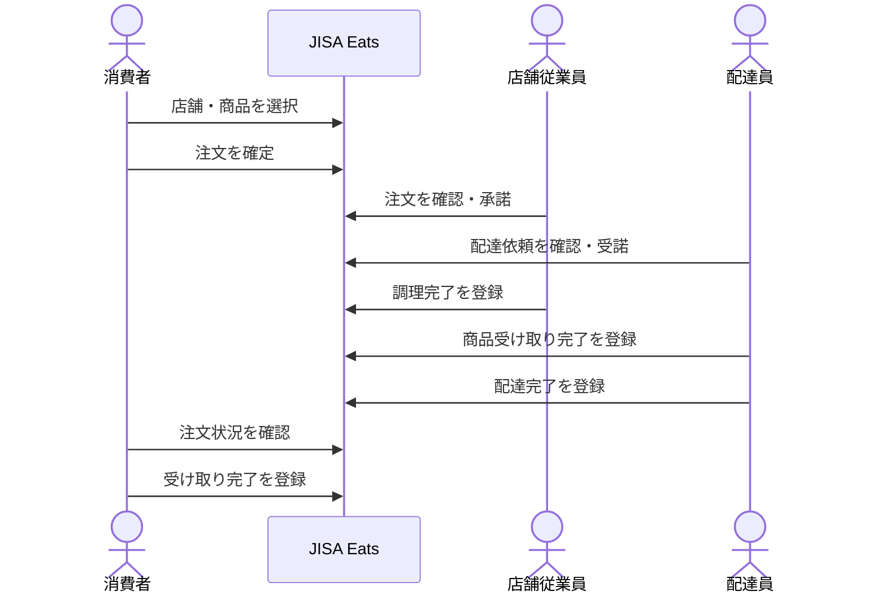
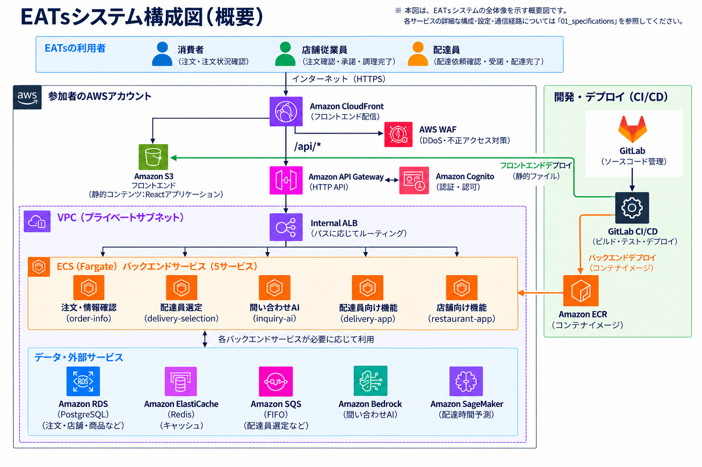

# JISA Eatsシステム概要

## 1. 本書について

本書は、技術コンテストで利用する「JISA Eats」の全体像と、
システムを調査・改善する際に参照するリポジトリ・ドキュメントの入口を示す資料です。

コンテストでは、各チームにJISA Eatsシステムの環境が提供されます。
参加者はシステムやAWS環境の状態を調査し、潜在する問題や課題を発見・改善しながら、
ビジネス成果の最大化を目指します。

システム構成やAWSリソースの詳細は、
[01_specifications](../01_specifications/01_specifications.md) を参照してください。

---

## 2. ドキュメント構成

参加者向けドキュメントは以下の構成です。

```text
00_overview/
├── 00_overview.md
└── regulations.md
01_specifications/
└── 01_specifications.md
02_inquiries/
└── user_inquiries.md
03_governanceComments/
└── governance_comments.md
05_howto/
└── README.md
```

| ドキュメント | 内容 |
|---|---|
| [00_overview/00_overview.md](./00_overview.md) | JISA Eatsシステム概要、リポジトリ構成、各資料への入口 |
| [00_overview/regulations.md](./regulations.md) | コンテスト参加時のレギュレーション |
| [01_specifications/01_specifications.md](../01_specifications/01_specifications.md) | システム構成、関連仕様・参照先 |
| [02_inquiries/user_inquiries.md](../02_inquiries/user_inquiries.md) | 利用者・現場から寄せられた問い合わせやコメント |
| [03_governanceComments/governance_comments.md](../03_governanceComments/governance_comments.md) | サービス運営・経営視点からのコメントや懸念 |
| [05_howto/README.md](../05_howto/README.md) | 各種操作手順書への入口 |

`02_inquiries` と `03_governanceComments` は、システムを調査するきっかけとなる事象や懸念を示す資料です。
課題や原因、改善方法を一覧化したものではありません。
実際のシステム、ログ、ソースコード等も確認し、原因と改善方法を調査してください。

---

## 3. JISA Eatsシステム概要

### 3.1 JISA Eatsとは

JISA Eatsは、消費者からの注文を受け付け、
飲食店での調理や配達員による配送を支えるフードデリバリーサービスです。

コンテストでは、単にシステムを動作させるだけではなく、
より多くの注文を安定して処理しながら必要なコストを抑え、
JISA Eatsビジネスの利益を高めることを目指します。

### 3.2 主な利用者

| 利用者 | ロール | 主な操作 |
|---|---|---|
| 消費者 | `consumer` | 店舗・商品の選択、注文、注文状況確認、受け取り完了 |
| 店舗従業員 | `restaurant` | 注文確認、注文承諾、調理完了 |
| 配達員 | `courier` | 配達依頼確認、受諾、商品受け取り、配達完了 |

### 3.3 主な機能

| 機能 | 概要 |
|---|---|
| 注文受付・情報確認 | 消費者からの注文受付、店舗・商品・注文情報の確認 |
| 店舗向け機能 | 注文の確認・承諾、調理完了の登録 |
| 配達員向け機能 | 配達依頼の確認・受諾、商品受け取り、配達完了 |
| 配達員選定 | 注文に対する配達員候補の選定 |
| 配達時間予測 | 配達予定時間の予測 |
| 問い合わせAI | 自然文による問い合わせに対するAI回答 |
| DevOps | コード変更のビルド・検証・デプロイ |

### 3.4 注文の基本的な流れ



画面上の注文状態は、基本的に以下の順で遷移します。

```text
店舗受付中
  ↓
店舗受付完了
  ↓
配達員選定中
  ↓
配達員選定完了
  ↓
調理完了
  ↓
配達中
  ↓
完了
  ↓
受け取り完了
```

---

## 4. コンテストで利用するシステム

コンテストでは、各チームに参加者が調査・改善する
JISA Eatsシステム環境が提供されます。

提供される機能と注文の基本的な流れは、第3章を参照してください。

システムの詳細な構成については、
[01_specifications](../01_specifications/01_specifications.md) を参照してください。

---

## 5. AWS全体構成

JISA Eatsシステムは、AWS上の複数のサービスを組み合わせて構成されています。

システム全体のAWS構成を以下に示します。



各AWSサービスやバックエンドサービス間の通信経路など、
より詳細なシステム構成については
[01_specifications](../01_specifications/01_specifications.md)
を参照してください。

---

## 6. GitLabリポジトリ構成

参加者が調査・改善するJISA Eatsシステムのアプリケーションコードは、
参加者向けGitLabリポジトリに配置されています。

JISA Eatsシステムのフロントエンドおよびバックエンドのコードは、
主に以下のディレクトリに配置されています。

```text
eats_system/
└── apps/
    ├── frontend/
    └── backend/
```

各バックエンドサービスの役割や構成については、
[JISA Eatsシステム仕様 4. アプリケーション構成](../01_specifications/01_specifications.md#4-アプリケーション構成) を参照してください。

---

## 7. どの資料を見ればよいか

| 知りたいこと | 参照先 |
|---|---|
| JISA Eatsがどのようなシステムか | [3. JISA Eatsシステム概要](#3-jisa-eatsシステム概要) |
| コンテスト参加時のルールを確認したい | [コンテスト参加時のレギュレーション](./regulations.md) |
| AWS全体構成を確認したい | [5. AWS全体構成](#5-aws全体構成) |
| GitLab上のアプリコード構成を確認したい | [JISA Eatsシステム仕様 4.1 GitLabリポジトリ構成](../01_specifications/01_specifications.md#41-gitlabリポジトリ構成) |
| AWS・ECS・ネットワーク・バックエンドサービス等の詳細を確認したい | [JISA Eatsシステム仕様 2. システム全体構成](../01_specifications/01_specifications.md#2-システム全体構成)から各章を参照 |
| 調査に使うログの出力先を確認したい | [JISA Eatsシステム仕様 4.5 ログ出力先](../01_specifications/01_specifications.md#45-ログ出力先) |
| 利用者等からの問い合わせ・意見を確認したい | [問い合わせ・ご意見](../02_inquiries/user_inquiries.md) |
| サービス運営・経営視点のコメントを確認したい | [サービス運営会議 議事メモ](../03_governanceComments/governance_comments.md) |
| 初回操作の順序と実施者を確認したい | [操作手順書：実施者について](../05_howto/README.md#実施者について) |
| アプリケーションを変更・デプロイしたい | [環境設定マニュアル 付録E. コードの修正方法](../05_howto/setup-manual.md#付録e-コードの修正方法) |
| JISA Eatsの画面を操作したい | [JISA Eats ユーザー操作手順書 2.1 本手順の実施順序](../05_howto/user-manual.md#21-本手順の実施順序) |
| 順位やスコアを確認したい | [運営システム ユーザー操作手順書 3.2 ダッシュボードを確認する](../05_howto/staff-system%20user-manual.md#32-ダッシュボードを確認する) |
| システム状況採点を実行したい | [運営システム ユーザー操作手順書 3.5 システム状況採点を実行する](../05_howto/staff-system%20user-manual.md#35-システム状況採点を実行する) |
| その他の操作手順を探したい | [操作手順書：目的別の参照先](../05_howto/README.md#目的別の参照先) |

---
