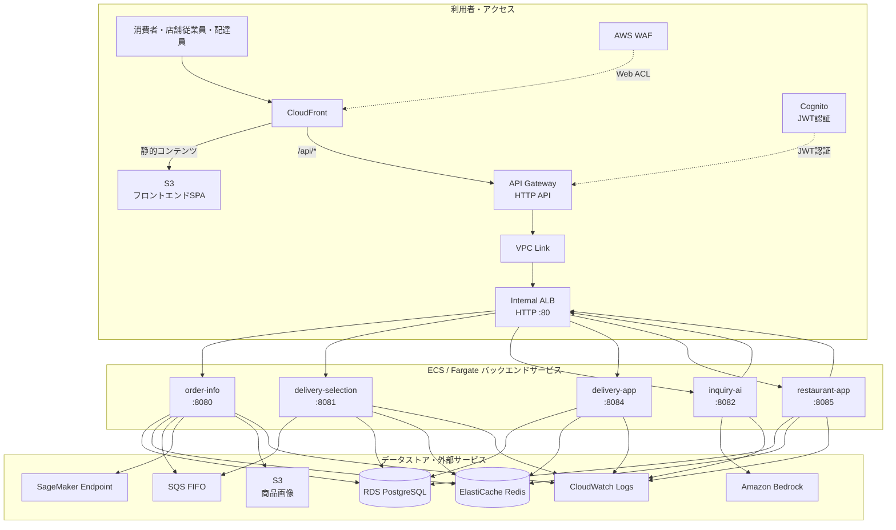

# JISA Eatsシステム仕様・システム構成

## 1. 本書について

本書では、JISA Eatsシステムのシステム構成、主要AWSサービス、アプリケーション、ECS Service、通信経路、ログ出力先、リポジトリ上の参照先を説明します。

JISA Eatsシステム全体の概要は [00_overview](../00_overview/00_overview.md) を参照してください。

初回アクセスや画面操作、CI/CDの具体的な手順は [操作手順書](../05_howto/README.md) を参照してください。目的別の参照先は本書の[8. 関連仕様・参照先](#8-関連仕様参照先)にも記載しています。

> [!NOTE]
> 本コンテストでは、注文代行AI（`order-proxy-ai`）は利用しません。
> `order-proxy-ai` に関するコードおよびAWSリソースは、調査・修正・動作確認の対象外です。
> なお、問い合わせAI（`inquiry-ai`）は別機能であり、本注記の対象には含みません。

---

## 2. システム全体構成

JISA Eatsシステムは、参加者ごとのAWSアカウント上に構築されます。
参加者向けの現行CloudFormation本体は `participant/infra/cfn-system.yaml` です。

フロントエンドへのアクセスとバックエンドAPIへのアクセスはCloudFrontを入口とします。
`/api/*` のリクエストはAPI Gateway、VPC Link、Internal ALBを経由してECS上のバックエンドサービスへルーティングされます。

参加者向け機能に関係する主な通信経路を以下に示します。



各バックエンドサービスの役割や個別の通信先は、4章および5章を参照してください。

---

## 3. 主要AWSサービスと役割

| AWSサービス | 役割 |
|---|---|
| CloudFront | JISA EatsフロントエンドおよびAPIアクセスの入口 |
| AWS WAF | CloudFrontに関連付けるWeb ACL |
| Amazon S3 | フロントエンド静的コンテンツ、商品画像、各種ログ・CI/CD関連データの格納 |
| Amazon API Gateway | `/api/*` リクエストを受けるHTTP API |
| VPC Link | HTTP APIからInternal ALBへプライベート接続 |
| Application Load Balancer | パスに応じて各ECS ServiceのTargetGroupへルーティング |
| Amazon ECS / Fargate | バックエンドサービスを実行 |
| Amazon ECR | バックエンドサービスのコンテナイメージを管理 |
| Amazon RDS for PostgreSQL | 注文、店舗、商品、配達員等のデータを格納 |
| Amazon ElastiCache for Redis | バックエンドサービスから利用するキャッシュ |
| Amazon SQS FIFO | 配達員選定依頼のメッセージング |
| Amazon Cognito | JISA Eats利用者の認証、`consumer` / `restaurant` / `courier` グループ管理 |
| Amazon Bedrock | 問い合わせAIから利用 |
| Amazon SageMaker | `order-info` から利用する配達時間予測用推論エンドポイント |
| CloudWatch Logs | ECS、HTTP API、RDS等のログを確認するために利用 |
| AWS CloudTrail | 監査ログ |
| AWS Secrets Manager | RDSマスターパスワードの管理 |
| VPC Endpoint | ECR、Logs、Bedrock、S3、SSM、SageMaker等へのプライベート接続 |
| AWS CloudFormation | JISA Eats環境の構成情報、既存スタック・Outputsの確認 |

---

## 4. アプリケーション構成

JISA Eatsのアプリケーションコードは参加者向けGitLabリポジトリに配置されています。

### 4.1 GitLabリポジトリ構成

参加者向け機能に関係する主な構成は以下のとおりです。

```text
eats_system/
└── apps/
    ├── frontend/
    └── backend/
        ├── order-info/
        ├── delivery-selection/
        ├── inquiry-ai/
        ├── delivery-app/
        └── restaurant-app/
```

### 4.2 バックエンドサービス

参加者向け機能で利用する主なバックエンドサービスを以下に示します。

| サービス | 主な機能 | ソースコード |
|---|---|---|
| `order-info` | 注文の登録・取得、店舗・商品情報の参照、配達見積もり、注文状態の更新など、注文処理の中心となる機能を提供 | `eats_system/apps/backend/order-info/` |
| `delivery-selection` | SQSから配達員選定依頼を受信し、注文に対する配達員候補の選定処理を実行 | `eats_system/apps/backend/delivery-selection/` |
| `inquiry-ai` | 利用者からの自然文による問い合わせを受け付け、Bedrockおよび`order-info`の情報を利用して回答を生成 | `eats_system/apps/backend/inquiry-ai/` |
| `delivery-app` | 配達員向けに配達依頼の確認・受諾、配達開始、配達完了等の業務機能を提供 | `eats_system/apps/backend/delivery-app/` |
| `restaurant-app` | 店舗向けに注文確認・注文承諾・調理完了等の業務機能を提供 | `eats_system/apps/backend/restaurant-app/` |

### 4.3 主な接続先

| サービス | 主な接続先 |
|---|---|
| `order-info` | RDS、Redis、SQS、SageMaker、商品画像S3 |
| `delivery-selection` | SQS、RDS、Redis、`order-info`（内部HTTP） |
| `inquiry-ai` | Bedrock、`order-info`（Tool useから内部HTTP） |
| `delivery-app` | RDS、Redis |
| `restaurant-app` | RDS、Redis、`order-info`（店舗承諾時の内部HTTP） |

サービスから `order-info` への内部呼び出しにはInternal ALBのDNS名が利用されます。

### 4.4 APIエンドポイント

以下は、各サービスのControllerと現行OpenAPIに基づく主要エンドポイントです。
API GatewayとALBは `/api/{proxy+}` とパスパターンを転送します。

| サービス | メソッド / パス | 概要 |
|---|---|---|
| `order-info` | `GET /api/orders` | 注文情報を取得 |
| `order-info` | `POST /api/orders` | 注文を登録 |
| `order-info` | `GET /api/orders/{orderId}` | 指定した注文の情報を取得 |
| `order-info` | `POST /api/orders/delivery-estimate` | 注文の配達時間見積もりを取得 |
| `order-info` | `POST /api/orders/{orderId}/receive-complete` | 注文の受け取り完了を登録 |
| `order-info` | `POST /api/orders/{orderId}/cancel` | 注文をキャンセル |
| `order-info` | `POST /api/orders/{orderId}/restaurant-accept` | 店舗による注文承諾を登録 |
| `order-info` | `GET /api/restaurants` | 店舗情報を取得 |
| `order-info` | `GET /api/restaurants/{restaurantId}/availability` | 指定店舗の利用可否・受付状況を取得 |
| `order-info` | `GET /api/restaurants/{restaurantId}/products` | 指定店舗の商品情報を取得 |
| `delivery-selection` | `GET /api/delivery-selection/health` | 配達員選定サービスの稼働状態を確認 |
| `inquiry-ai` | `POST /api/inquiry-ai/ask` | 問い合わせ内容を送信し、AI回答を取得 |
| `delivery-app` | `GET /api/delivery-app/assignments` | 配達員に割り当てられた配達依頼を取得 |
| `delivery-app` | `POST /api/delivery-app/accept/{orderId}` | 配達依頼を受諾 |
| `delivery-app` | `POST /api/delivery-app/start-delivery/{orderId}` | 配達開始を登録 |
| `delivery-app` | `POST /api/delivery-app/delivery-complete/{orderId}` | 配達完了を登録 |
| `restaurant-app` | `GET /api/restaurant-app/me` | ログイン中の店舗情報を取得 |
| `restaurant-app` | `GET /api/restaurant-app/{restaurantId}/orders` | 指定店舗の注文一覧を取得 |
| `restaurant-app` | `POST /api/restaurant-app/{restaurantId}/accept/{orderId}` | 店舗が注文を承諾 |
| `restaurant-app` | `POST /api/restaurant-app/{restaurantId}/cooking-complete/{orderId}` | 調理完了を登録 |

`delivery-selection` の主処理はSQS FIFOのポーリングです。

### 4.5 ログ出力先

問題調査や動作確認では、各AWSサービスに出力されるログを参照できます。

#### ECSバックエンドサービス

主なECS / Fargateバックエンドサービスでは、
コンテナの標準出力・標準エラーをCloudWatch Logsへ出力します。

| サービス | CloudWatch Logs ロググループ |
|---|---|
| `order-info` | `/ecs/${ProjectName}/order-info` |
| `delivery-selection` | `/ecs/${ProjectName}/delivery-selection` |
| `inquiry-ai` | `/ecs/${ProjectName}/inquiry-ai` |
| `delivery-app` | `/ecs/${ProjectName}/delivery-app` |
| `restaurant-app` | `/ecs/${ProjectName}/restaurant-app` |

ログストリームはECSタスクごとに作成されます。
各ロググループの保持期間は30日です。

#### API Gateway

API Gateway HTTP APIのアクセスログは、CloudWatch Logsへ出力されます。

- ロググループ：`/apigw/${ProjectName}/http-api-access`
- 保持期間：30日
- 主な記録内容：HTTPメソッド、パス、ステータスコード、レスポンス時間等

リクエスト／レスポンス本文はアクセスログには出力されません。

#### RDS PostgreSQL

RDS PostgreSQLでは、以下のログがCloudWatch Logsへ出力されます。

| ロググループ | 内容 |
|---|---|
| `/aws/rds/instance/${ProjectName}-eats-db/postgresql` | PostgreSQLの接続、SQL、エラー等 |
| `/aws/rds/instance/${ProjectName}-eats-db/upgrade` | DBアップグレード時のログ |

#### その他の主なログ・監査情報

| 対象 | 出力先・確認先 |
|---|---|
| CloudFrontアクセスログ | S3（`CloudFrontAccessLogsBucket`） |
| CloudTrail監査ログ | S3（`CloudTrailLogsBucket`） |
| AWS WAF | CloudWatchメトリクス、サンプルリクエスト |
| DB初期化（初期データ投入・リセット）Lambda：`jisa2026-lambda-initialize-for-traffic` | CloudWatch Logs：`/aws/lambda/jisa2026-lambda-initialize-for-traffic` |
| CI/CD実行結果 | GitLab Pipelineの各Jobログ・Artifacts |

Internal ALBのアクセスログ、Redisのログ配送、VPC Flow Logsについては、
本環境ではログ出力先を設定していません。

### 4.6 フロントエンド

フロントエンドは React 18.3.1、TypeScript 5.6.3、React Router 6.28.0、Vite 6.0.1、`amazon-cognito-identity-js` を使用します。

Cognito User Poolで認証し、JWT Bearer tokenをAPI呼び出しに使用します。
画面設計では、ログイン、消費者向け店舗・商品・注文・注文状況、店舗向け注文、配達員向け配達、問い合わせAIを定義しています。
ロールは `consumer`、`restaurant`、`courier` です。

---

## 5. 主な通信の流れ

### 5.1 フロントエンド

```text
利用者
  ↓
CloudFront
  ↓
S3（フロントエンド静的コンテンツ）
```

### 5.2 API

```text
利用者
  ↓
CloudFront
  ↓ /api/*
API Gateway HTTP API
  ↓ Cognito JWT認証
VPC Link
  ↓
Internal ALB :80
  ↓
Listener Rule
  ↓
TargetGroup
  ↓
ECS Service
```

### 5.3 配達員選定

```text
order-info
  ↓
SQS FIFO
  ↓
delivery-selection
  ↓
Internal ALB
  ↓
order-info
```

### 5.4 問い合わせAI

```text
利用者
  ↓
inquiry-ai
  ├─→ Amazon Bedrock
  └─→ Internal ALB → order-info
```


> [!NOTE]
> 本コンテストでは、Amazon Bedrock Guardrailsの利用は想定していません。
> ECSタスクロールにはGuardrailsを利用するための権限は付与されていないため、
> 問い合わせAIに対する安全性の改善は、提供されている権限の範囲内で
> アプリケーション側の実装により対応してください。

### 5.5 データストア・外部サービスの用途

| 要素 | 利用サービス | 主な用途 |
|---|---|---|
| RDS PostgreSQL | `order-info`、`delivery-selection`、`delivery-app`、`restaurant-app` | 店舗・商品・注文・注文明細・配達候補などの永続化 |
| Redis | `order-info`、`delivery-selection`、`delivery-app`、`restaurant-app` | 注文・配達候補等のキャッシュ |
| SQS FIFO | `order-info`、`delivery-selection` | `order-info` が配達員選定依頼を送信し、`delivery-selection` が選定処理を受信する。選定結果用キューも定義されている |
| SageMaker Endpoint | `order-info` | 配達先等を入力した配達時間予測の推論 |
| Bedrock | `inquiry-ai` | 問い合わせの意図解析・回答生成 |
| S3 | `order-info` | 商品画像の格納と、商品画像取得用URLの生成 |

`inquiry-ai` はBedrockのTool useループから `order-info` の内部APIを呼び出します。

BedrockのモデルID、SageMakerのエンドポイント名、各接続先は `cfn-system.yaml` のECS環境変数で渡されます。

---

## 6. ECS Service ⇔ TargetGroup ⇔ Port 対応表

参加者向け機能で利用する主なECS ServiceとTargetGroup、Container Portの対応を以下に示します。

| ECS Service | Container | TargetGroup | Container Port | ALB Listener Port |
|---|---|---|---:|---:|
| `${ProjectName}-order-info` | `order-info` | `${ProjectName}-order-tg` | 8080 | 80 |
| `${ProjectName}-delivery-selection` | `delivery-selection` | `${ProjectName}-delivery-tg` | 8081 | 80 |
| `${ProjectName}-inquiry-ai` | `inquiry-ai` | `${ProjectName}-inq-ai-tg` | 8082 | 80 |
| `${ProjectName}-delivery-app` | `delivery-app` | `${ProjectName}-del-app-tg` | 8084 | 80 |
| `${ProjectName}-restaurant-app` | `restaurant-app` | `${ProjectName}-rest-app-tg` | 8085 | 80 |

上表に記載した各ServiceのTaskDefinition側のContainer Portも同じ値で定義されています。

`cfn-system.yaml` では、上表に記載した各ECS Serviceの `DesiredCount` は `2` です。
各Serviceの `TaskDefinition` は対応する `${ProjectName}-<service>` FamilyのTaskDefinitionを参照し、TaskDefinitionのContainerNameとPortMappingsも上表のContainer・Portと一致します。

---

## 7. Internal ALBのルーティング

Internal ALBはHTTP `80` で待ち受け、パスに応じてTargetGroupを切り替えます。
参加者向け機能で利用する主なルーティングを以下に示します。
初回CI/CD確認時の状態と操作については、環境設定マニュアルの4.5～4.7も参照してください。

| Priority | パス | TargetGroup |
|---:|---|---|
| 10 | `/api/orders*`, `/api/restaurants*`, `/internal/orders*` | `${ProjectName}-order-tg` |
| 20 | `/api/delivery-selection*` | `${ProjectName}-delivery-tg` |
| 30 | `/api/inquiry-ai*` | `${ProjectName}-inq-ai-tg` |
| 50 | `/api/delivery-app*` | `${ProjectName}-del-app-tg` |
| 60 | `/api/restaurant-app*` | `${ProjectName}-rest-app-tg` |

どのルールにも一致しない場合、ALBのデフォルトアクションはHTTP `404` を返します。

---

## 8. 関連仕様・参照先

| 資料・仕様 | 参照先 |
|---|---|
| JISA Eatsシステム概要 | [00_overview](../00_overview/00_overview.md) |
| 初回操作の順序・実施者 | [操作手順書：実施者について](../05_howto/README.md#実施者について) |
| AWSへの初回ログイン・MFA設定 | [環境設定マニュアル 第1章](../05_howto/setup-manual.md#1-aws環境アクセス)・[第2章](../05_howto/setup-manual.md#2-mfa設定) |
| GitLabへのアクセス確認 | [環境設定マニュアル 第3章](../05_howto/setup-manual.md#3-gitlabへのアクセス確認) |
| CI/CDによるデプロイと結果確認 | [環境設定マニュアル 第4章](../05_howto/setup-manual.md#4-cicdによるアプリケーションのデプロイ) |
| コードの修正・反映操作 | [環境設定マニュアル 付録E. コードの修正方法](../05_howto/setup-manual.md#付録e-コードの修正方法) |
| JISA Eatsの画面操作 | [JISA Eats ユーザー操作手順書 2.1 本手順の実施順序](../05_howto/user-manual.md#21-本手順の実施順序) |
| RDSへの接続 | [RDS接続手順](../05_howto/rds-connection-manual.md) |
| GitLab・CI/CD用インスタンスの停止・再開 | [インスタンスの停止・再開マニュアル](../05_howto/stop-instances-manual.md) |
| 順位・スコアの確認、システム状況採点の実行 | [運営システム ユーザー操作手順書](../05_howto/staff-system%20user-manual.md) |
| DBの初期化 | [疑似トラフィック後のDB初期化手順](../05_howto/traffic-db-reset-manual.md) |
| 配達時間予測モデルの確認・改善 | [データ分析](../05_howto/data_analysis/data_analysis.md) |
