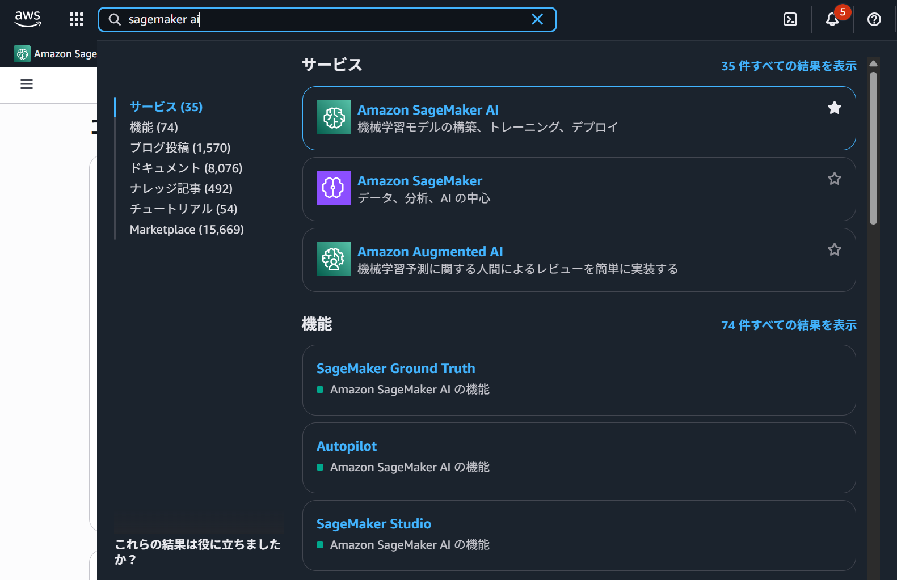
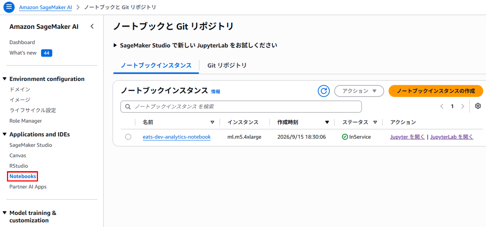
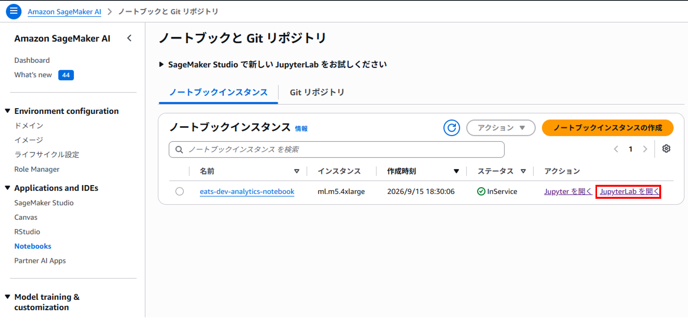
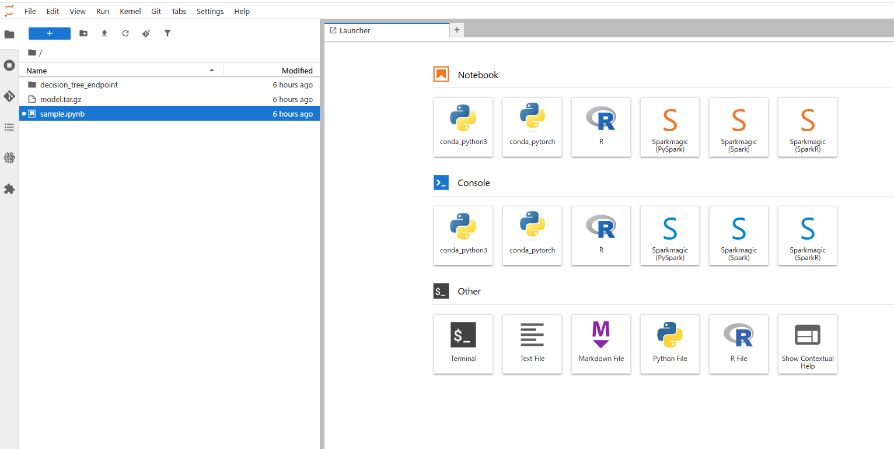
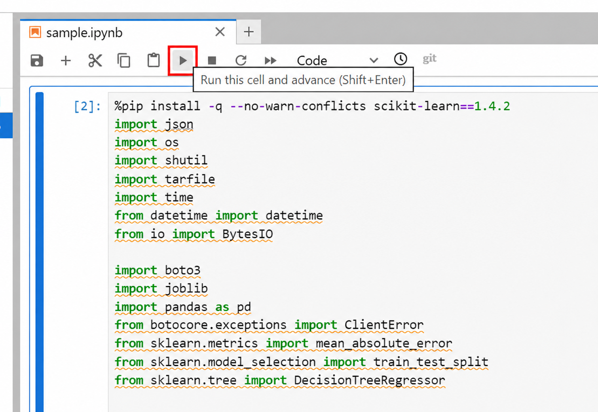
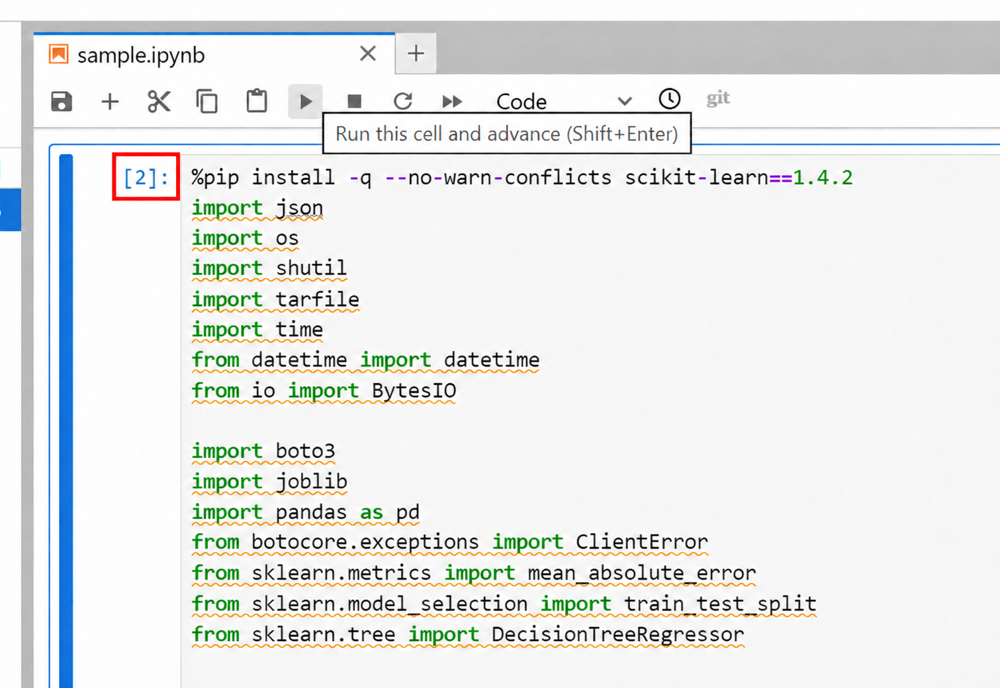

# データ分析

## 手順書

手順は大きく以下の4フェーズから構成されます

1. AWS上での開発環境として、SageMaker上のJupyterLabにアクセスする
2. スクリプトを実行し、生じるエラーに対処する
3. モデルの精度が高くなるように試行錯誤を行う
4. 試行錯誤の結果、ベストモデルを選択し、運営が保有している精度検証用の1000件のデータに対して推論を行う環境であるエンドポイントへデプロイする

以下に、各フェーズの詳細手順を示します。

### 1. JupyterLabへのアクセス

1. AWSコンソールの検索窓に「sagemaker ai」を入力し、サービスから「Amazon SageMaker AI」をクリックします。

   

2. 左側のナビゲーションバーから「Applications and IDEs」>「Notebooks」をクリックします

   

3. `eats-dev-analytics-notebook` というインスタンスの「アクション」にある「JupyterLabを開く」をクリック

   

4. 以下の画面が表示されれば成功です

   

### 2. スクリプトの取得と精度改善

1. JupyterLabのホーム画面から [`sample.ipynb`](script/sample.ipynb) を開きます。
2. 最初のセルを上から順に実行します。途中でエラーが発生するため、原因を考えて修正してください。
3. エラーを解消したら、検証データに対するMAEを確認します。MAEは、予測した配達時間と実際の配達時間が平均してどの程度ずれているかを表す値です。値が小さいほど、予測誤差が小さいことを意味します。
4. 特徴量エンジニアリングやモデルの変更など、複数回の試行錯誤を行い、MAEの値を確認しながらベストモデルを選択します。通常はMAEの値が小さいほど精度が良いモデルなので特段理由がない限りはMAEが小さいモデルを選択すれば良いです。
5. 選択したベストモデルをエンドポイントにデプロイします。（エンドポイントにデプロイされたモデルを用いて運営側で精度を検証します）

#### コードの流れ

ノートブック内では、処理のまとまりが次のようなコメントで区切られています。ここでは、精度改善と動作確認に関係する主要な部分だけを説明します。該当するコメントをノートブック内で探しながら確認してください。

```python
# ============================================================
# Feature engineering for training
# ============================================================
```

注文データと店舗情報を店舗IDで結合し、学習に使用するデータを作成します。  
初期状態では上記の処理しかしていないため、試行錯誤では主にこの付近を変更します。

```python
# ============================================================
# Train / evaluate
# ============================================================
```

モデルを学習したデータだけで評価すると、未知のデータに対する予測性能を正しく判断できません。そのため、データを学習用と検証用に分け、学習に使用していない検証用データでMAEを確認します。  
学習データ＝受験勉強、検証データ＝全国模試、運営側の1000件のデータ＝本番の受験、というようなイメージです。  

`sample.ipynb` では、学習データをモデル学習用と検証用に分割します。  
モデル学習時に表示されるMAEは、この検証用データに対する予測誤差です。  
モデルや特徴量を変更する前後でこのMAEを比較し、値が小さくなる方向に改善を進めてください。

なお、この検証用データは正式採点に使用するデータとは異なるため、`sample.ipynb` に表示されるMAEと正式な採点結果は必ずしも一致しません。
正式採点では、運営側が用意した1000件のテストデータを用いて別途評価を行い、結果に応じたスコアを参加者ダッシュボードで確認できます。

尚、最初に発生するエラーでは、学習時と予測時に渡している特徴量の数や並びに注目して修正対応を行ってください。

```python
# ============================================================
# Inference code executed inside the SageMaker endpoint
# ============================================================
```

SageMakerエンドポイント内で実行する推論処理です。受け取ったJSONから特徴量を作成し、学習済みモデルで予測した結果をJSONとして返します。この中の `create_features` が、エンドポイント側で特徴量を作成する処理です。

> [!重要]
> 学習側と`inference_code` 内の推論側で、特徴量の名前・数・順序・データ型を一致させる必要があります。一致していない場合、学習と検証が成功しても、エンドポイントの呼び出し時にエラーが発生したり、意図しない予測結果になったりします。
>
> ただし、試行錯誤のたびにエンドポイントにおける推論側のコードまで修正する必要はありません。まずは学習・検証データで特徴量やモデルを変更してMAEを比較し、エンドポイントへデプロイするモデルと特徴量が決まった時点で、その結果だけをエンドポイントにおける推論側のコードへ反映してください。精度が低く、不採用となる試行内容まで反映する時間が無駄であるためです。
>
> `inference_code` には、エンドポイント内の不具合を追跡するためのログ出力や入力検証、モデルファイル更新も含まれているため、コード量が多くなっています。採用した特徴量の作り方を推論側へ反映する場合、通常は `create_features` 関数を修正すれば十分です。特徴量以外の入出力仕様などを変更しない限り、その他の処理を修正する必要はありません。

```python
# ============================================================
# Build model artifact
# ============================================================
```

この見出しはノートブック内に2回あります。1つ目では、学習済みモデル、店舗情報、特徴量の一覧を保存します。2つ目では、それらに推論スクリプトを加えて、エンドポイントへ配置する1つのファイルにまとめます。

```python
# ============================================================
# Create EndpointConfig / Endpoint
# ============================================================
```

直前の処理でS3へ保存・登録したモデルを使い、SageMakerエンドポイントを構築します。エンドポイントがすでに存在する場合は、新しいモデルを使用する設定へ更新します。ステータスが `InService` になると呼び出し可能です。

> [!WARNING]
> **デプロイ処理を途中から再実行する場合の注意**
>
> SageMakerのモデル名とエンドポイント設定名は、最初のセルを実行した時刻を使って作成されます。  
> モデルまたはエンドポイント設定の作成後に処理が失敗した場合、デプロイ用のセルだけを再実行すると、同じ名前のAWSリソースを再作成しようとして、`already exists` などのエラーが発生することがあります。
>
> このエラーが発生した場合は、次の手順で再実行してください。
>
> 1. エラーメッセージを確認し、原因となったコードや設定を修正します。
> 2. 最初のセルから順番にすべてのセルを再実行します。
> 3. エンドポイントのステータスが `InService` になったことを確認します。
> 4. 最後の動作確認を実行し、予測結果が返ることを確認します。
>
> 最初のセルを再実行すると新しいモデル名とエンドポイント設定名が生成されます。エンドポイント名は変更せず、運営が指定した名前を使用してください。
>
> 上記の手順でも解消しない場合や、エンドポイントのステータスが長時間 `Creating`、`Updating`、`Failed` のままになっている場合は、エンドポイントを削除したり名前を変更したりせず、表示されているステータスとエラーメッセージを運営担当者へ連絡してください。

```python
# ============================================================
# Direct invocation benchmark
# ============================================================
```

サンプルデータをJSONでエンドポイントへ送り、予測結果と処理時間を確認します。例として３件で確認していますが、任意で変更可能です。この処理はAPI GatewayやLambdaを経由せず、SageMakerエンドポイントを直接呼び出します。運営側によるLambdaを用いた精度検証の前に手元でエンドポイントにおいてエラーが出ないかなど、挙動を確認したい場合に活用するもので、毎回必須の処理ではないですが、運営側の評価を受ける前に、少なくとも1回は実行し、エンドポイントから正常に予測結果が返ることを確認してください。なお、`Direct invocation benchmark` は、デプロイしたSageMakerエンドポイントで正常に推論できることを確認するためのものです。モデルの精度評価を行う処理ではありません。

#### 精度改善の進め方

1. まずエラーを解消し、試行錯誤前の基準となるMAE＝機械学習モデルの精度を確認します。
2. 機械学習モデルが予測に使用するデータ列を「特徴量」と呼びます。今回のデータでは、注文者や店舗の緯度・経度、注文金額、商品数などが特徴量として使われています。元のデータから、機械学習モデルが配達時間との関係を捉えやすい新しいデータを作ることを「特徴量エンジニアリング」と呼びます。  
   例えば、注文者と店舗の緯度・経度をそのまま使用するだけでなく、2地点の位置関係を分かりやすく表す値へ加工できないか考えてみてください。特徴量エンジニアリングの際、各データを棒グラフや散布図などで可視化して観察してみるのも有効な手段です。
3. 初期の状態では特に特徴量エンジニアリングを行っておらず、また機械学習モデルも決定木という初期のベースラインモデルなので、特徴量エンジニアリングやより精度の高い機械学習モデルへ切り替えることで精度改善が期待できます。なお、試行錯誤の際、一度に複数の変更を加えると、どの変更がどれだけ寄与したのかわからなくなる点注意が必要です。
4. 採用するモデルが決まったら、モデルファイルの作成からエンドポイントの更新を行います。必要に応じて、エンドポイントで正常に動作するか、動作確認までを実行します。  
   ※繰り返しになりますが、エンドポイント側で変更が必要な箇所は、基本的に推論コード内の `create_features` 関数のみです。モデルファイルの作成・S3へのアップロード・エンドポイントの更新処理は、既存のコードを変更せずに利用できます。ただし、特徴量を変更した後は各セルを再実行し、再学習したモデルと変更後の推論コードをエンドポイントへ反映してください。

---

## 付録：JupyterLabの基本操作

### コードセルを1つ実行する

JupyterLabでは、コードが入力された枠を「コードセル」と呼びます。実行したいコードセルをクリックして選択し、次のいずれかの方法で実行します。

- `Shift` + `Enter` キーを押す：選択中のセルを実行し、次のセルへ移動します。
- ノートブック上部の実行ボタン（▶）をクリックする：選択中のセルを実行します。

基本的にはノートブックの上から順に、1セルずつ実行してください。前のセルで作成した変数や読み込んだライブラリを後のセルで使用するため、順番を飛ばすとエラーになることがあります。



### 実行中・実行完了を確認する

コードセル左側の角括弧と、画面上部にあるカーネルの状態を確認します。

| 表示 | 状態 |
| --- | --- |
| `[ ]` | そのセルはまだ実行されていません。 |
| `[*]` | そのセルを実行中です。完了するまで待ってください。 |
| `[1]`、`[2]` などの数字 | 実行が完了しています。数字はセルが実行された順番を示します。 |

処理内容によっては完了まで数分かかることがあります。`[*]` と表示されている間は、同じセルを続けて実行せずに待ってください。

実行が完了しても、セルの下に赤いエラーメッセージが表示された場合は処理に失敗しています。エラーメッセージを確認し、原因を修正してから再実行してください。



この例では、コードセル左側に実行番号 `[2]` が表示されているため、セルの実行が完了していることを確認できます。
