# 環境設定マニュアル（参加者向け）

## 目次

1. [AWS環境アクセス](#1-aws環境アクセス)
2. [MFA設定](#2-mfa設定)
3. [GitLabへのアクセス確認](#3-gitlabへのアクセス確認)
4. [CI/CDによるアプリケーションのデプロイ](#4-cicdによるアプリケーションのデプロイ)  
[付録](#付録)

## 1. AWS環境アクセス

対象システム: **JISA Eats**

> **実施者：チーム全員**
>
> AWSマネジメントコンソールへの初回ログインおよびMFA設定は、各メンバーが自身の参加者用アカウントで実施してください。

> **注意**
>
> チームごとのAWSアカウントIDは、他のチームへ絶対に共有しないでください。

### 環境情報

| 項目 | 値 |
| :--- | :--- |
| リージョン | 東京 `ap-northeast-1` |
| アカウントID / ユーザー名 / パスワード | 各参加チームのプライベートチャネルに紐づくSharePoint直下に配置したテキストファイルを参照してください |

### ログイン手順

1. [AWS トップページ](https://aws.amazon.com/jp/) を開き、画面右上の **「コンソールにサインイン」** を選択する。

   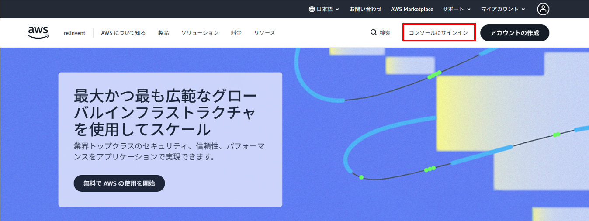

2. **「IAM user sign in」** 画面で、配布された認証情報を入力する。

   - `Account ID or alias`: 配布されたアカウントID
   - `IAM username`: 配布されたユーザー名
   - `Password`: 配布されたパスワード

   入力後、**「Sign in」** を選択する。

   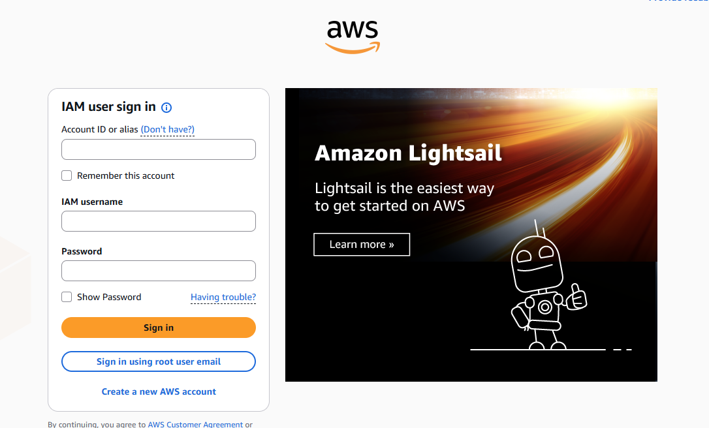

3. 初回ログイン時は **パスワードの変更（Password reset）** 画面が表示される。現在のパスワード（Old Password）と新しいパスワード（New Password）を入力し、サインインを完了する。

   > [!WARNING]
   > 新しいパスワードが短かったり、記号が含まれていない場合など、アカウントのパスワードポリシーを満たしていないとエラーが表示され、変更できません。エラーが表示された場合は、より長く記号を含んだパスワードを設定し直してください。

   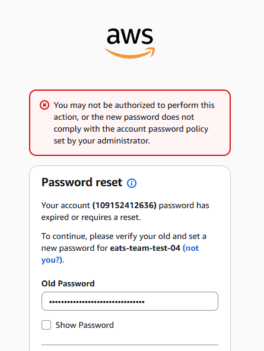

4. リージョンが **東京（`ap-northeast-1`）** になっているか確認し、異なる場合は右上から切り替える。

## 2. MFA設定

> ログイン直後に必ず設定してください。

MFA デバイスは認証アプリ・パスキーなどから任意のものを選択できます。**本マニュアルでは認証アプリ（推奨）** の登録手順を説明します。パスキーやセキュリティキーを使う場合は、末尾の「参考: その他のMFA方式」を参照してください。

### 事前準備

- 【認証アプリを選択する場合】スマートフォンに MFA 用の認証アプリ（例: Google Authenticator、Microsoft Authenticator）をインストールしておく。
  - 対応アプリは [IAM の多要素認証 (MFA)](https://aws.amazon.com/jp/iam/features/mfa/) の「仮想 MFA アプリケーション」を参照。

### 設定手順（認証アプリ）

1. 画面右上のアカウントメニュー（ユーザー名）を開き、**「セキュリティ認証情報」** を選択する。

   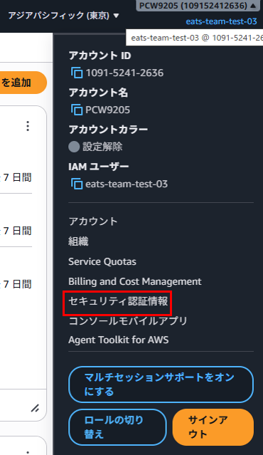

2. **「多要素認証（MFA）」** セクションの **「MFA デバイスの割り当て」** を選択する。

   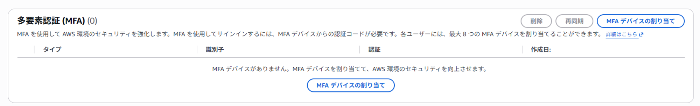

3. **「MFA デバイスを選択」** 画面で、デバイス名に **自身のAWSユーザー名** （例: tech-u01）を入力し、デバイスオプションで **「認証アプリケーション」** を選択して **「次へ」** を選択する。

   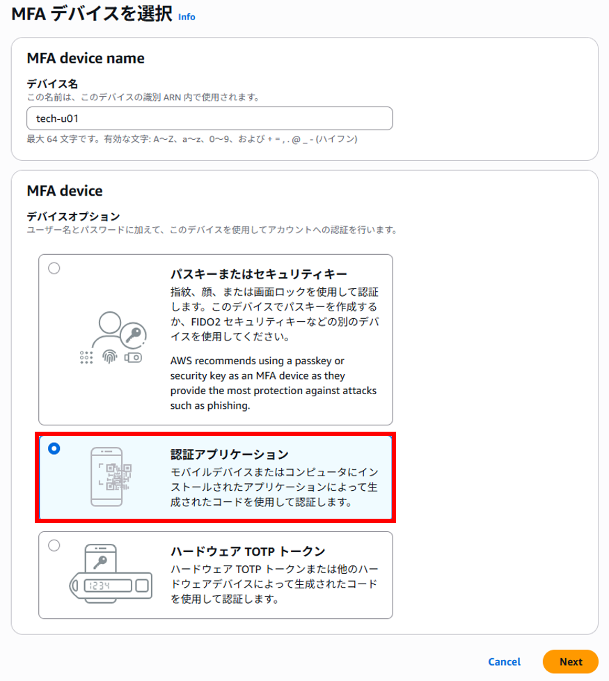

4. **「デバイスの設定」** 画面に表示された **QR コード** を、スマートフォンの認証アプリで読み取る。

5. 認証アプリに表示される **連続した 2 つの MFA コード** を順に入力し、**「MFA を追加」** を選択する。

   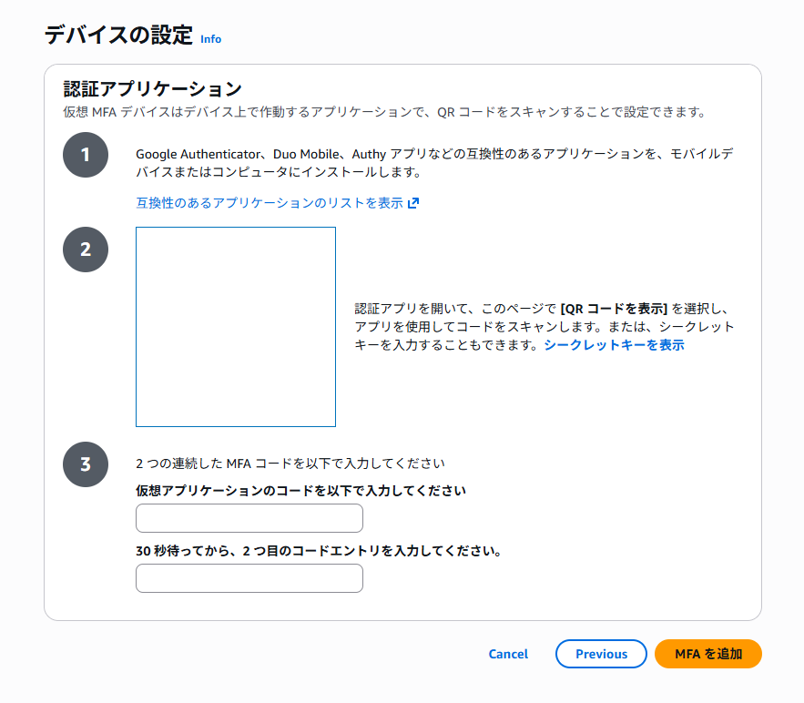

6. MFA デバイスが追加されれば登録完了。

> [!WARNING]
> コード入力の途中で画面を閉じると MFA の削除が必要になる場合があります。登録完了まで進めてください。

### 反映確認

- 一度サインアウトし、認証アプリのコードで再ログインできることを確認する。
- 再ログイン後、MFA の権限が反映され、**CloudFormation のスタックにアクセスできる** ようになります。以下の手順で確認してください。
  1. マネジメントコンソール上部の検索欄で **「CloudFormation」** を検索し、CloudFormation コンソールを開く。
  2. リージョンが **東京（`ap-northeast-1`）** になっていることを確認する。
  3. **「スタック」** の一覧が表示され、権限エラーが出ずに閲覧できれば MFA の反映は完了です。

   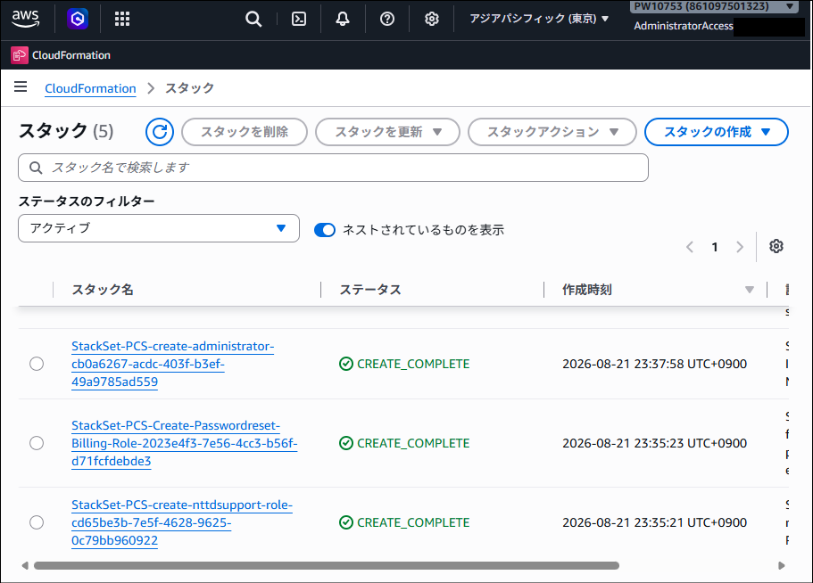

> [!WARNING]
> MFA が未設定、または設定後にサインアウト・再ログインしていない（反映されていない）場合は、CloudFormation を開いても下図のように **「スタックをロードできませんでした」** と表示され、スタックを操作できません。この画面が出た場合は、MFA の設定を完了したうえで、一度サインアウトしてから再ログインしてください。
>
> 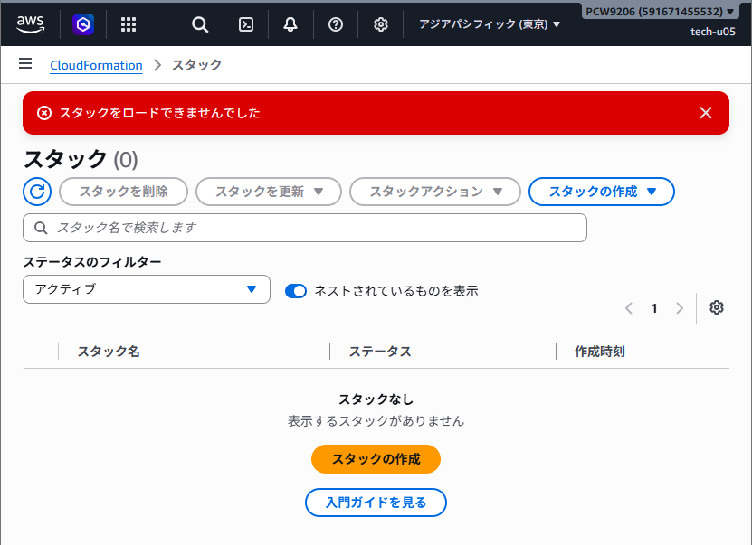

> [!NOTE]
> サインアウトせずに以降の作業を進めると権限エラーが発生します。必ずサインアウトしてください。

### 参考: その他のMFA方式（パスキー / セキュリティキー）

認証アプリ以外に、**パスキー（指紋・顔・PIN による認証、または FIDO2 セキュリティキー）** も利用できます。手順は認証アプリとほぼ同じで、手順 3 のデバイスオプションで **「パスキーまたはセキュリティキー」** を選択します。

- 手順 4 では、表示されるダイアログ（Windows の場合は「Windows セキュリティ」）で **「続行」** を選択してパスキーを保存し、指紋・顔・PIN などで本人確認を行う。Windows PC では Windows Hello を利用できる。
- **「Passkey MFA device assigned」** と表示されれば登録完了。

   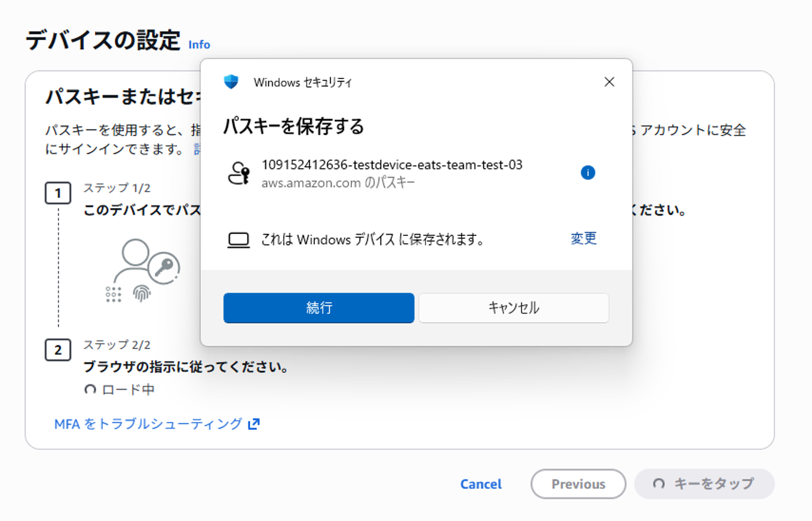

## 3. GitLabへのアクセス確認

> **実施者：チーム全員**
>
> 各メンバーがGitLabへログインでき、対象プロジェクトを参照できることを確認してください。

運営から配布されたAWSアカウントと環境を使用し、GitLabのURLを確認して、対象プロジェクトへアクセスできることを確認します。

### 3.1 前提条件

- 各チームにAWSアカウントが割り当てられていること。
- 第1章・第2章を完了し、初回パスワード変更・MFA設定後に **一度サインアウトして再ログイン** していること。

### 3.2 GitLabへのアクセス確認

GitLabのURLを確認し、対象プロジェクトへアクセスできることを確認します。

1. AWSマネジメントコンソール右上のリージョンを **アジアパシフィック（東京）`ap-northeast-1`** に変更する。

2. 「CloudFormation」から、`tech-contest` を開く。 

   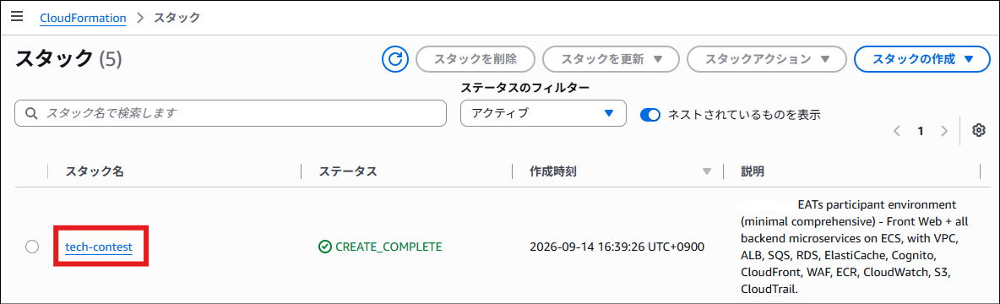

3. 「出力」タブで「CloudFrontDomain」の値をコピーする。

   

4. ブラウザで新しいタブを開き、コピーしたドメインを貼り付け `/gitlab` を末尾に加えてアクセスする。

   

5. 以下の参加者アカウントでGitLabへログインする。  
   - ユーザー名：`participant`  
   - パスワード：`techcontest9999`

   

6. 左ペインから **Projects** を開き、**Member** タブを選択する。

   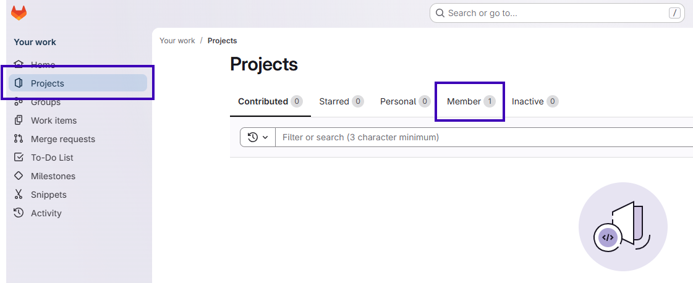

7. プロジェクト一覧から **`Administrator / TechContest`** を開く。

   

8. リポジトリが問題なく表示されることを確認する。

## 4. CI/CDによるアプリケーションのデプロイ

### 4.1 本章の目的

本章では、あらかじめ運営側で用意された CI/CD 環境を使用し、GitLab のパイプラインを実行して、アプリケーションが AWS 環境へデプロイされることを確認します。

本章の目的は次のとおりです。

- GitLab Pipeline が正しく動作することを確認する
- GitLab Pipeline の使い方を体験して学ぶ
- ECS 上のアプリケーション（コード）を最新へ更新する

> [!NOTE]
> ブランチの作成、マージリクエストの作成、その他の一般的な Git 操作は本編に含めません。必要な場合は「付録」を参照してください。

### 4.2 事前に準備されている環境

本章を開始する時点で、次の環境は事前に準備されています。

- JISA Eatsシステムを構成するAWSリソース
- GitLabの公開URL、Cognitoユーザープールの初期データ、RDS（PostgreSQL）のスキーマ・初期データ
- GitLab Runnerやパイプラインなど、CI/CDを実行するための環境

参加者が本章で実施するのは次のとおりです。

- GitLabの対象プロジェクトを開く（4.4）
- 初回のCI/CDパイプラインを実行する（4.5）
- 初期状態の問題を確認・修正する（4.6・4.7）
- デプロイ結果を確認する（4.8）
- アプリケーションコードを修正する場合は「付録E. コードの修正方法」を参照する

#### システム修正時に利用できる操作

システムを修正する際は、以下の方法を利用してください。

- アプリケーションの修正は、GitLabへ変更を登録し、CI/CDパイプラインを経由して反映してください。
- インフラ設定の修正には、AWSマネジメントコンソール、AWS CLI、CloudShellを利用できます。ただし、運営から提供されたIAM権限の範囲内で実施してください。IAM権限によって制限されている操作は、参加者による変更対象外です。
- 参加者によるCloudFormationスタックの作成・更新（CloudFormationテンプレートの実行）は行わないでください。
- CloudFormationは、既存スタックの状態や出力値などの確認に利用できます。
- 運営から提供されたIAMロールおよびIAMポリシーへの権限の追加・変更は行わないでください。

設定変更の反映等のため既存リソースの再起動が必要となる場合は、評価・採点の実行中を避け、影響範囲を確認したうえで実施してください。

前提条件:

- 第3章を完了し、GitLabへアクセスできること。
- JISA EatsのECSサービスが起動していること。
- 参加者用アカウントでGitLabへログインできること。

### 4.3 CI/CDの全体像

GitLab にコードを反映するとパイプラインが起動し、パイプライン内でテストとビルド・デプロイが実行されます。デプロイ先は ECS（バックエンド）と S3（フロントエンド）です。

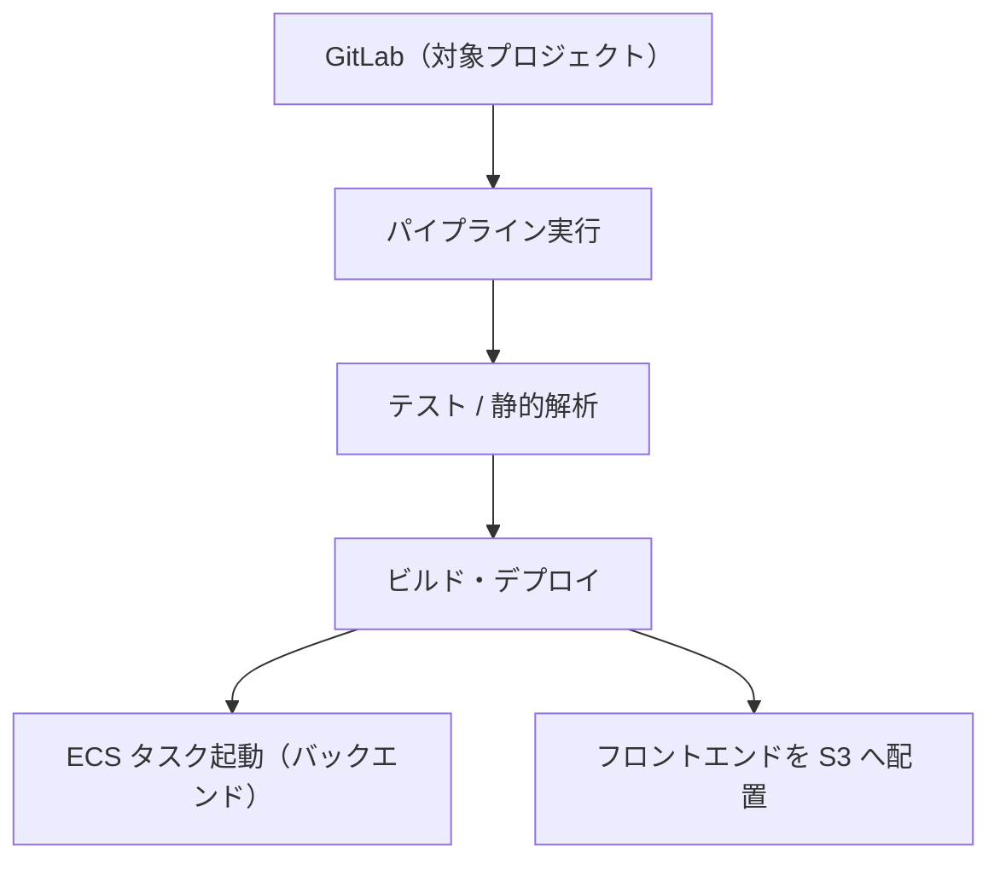

### 4.4 GitLabの対象プロジェクトを開く

1. GitLabへログインする。

2. 左ペインから **Projects** を開き、**Member** タブを選択する。

   

3. プロジェクト一覧から **`Administrator / TechContest`** を開く。

   

4. **`main`** ブランチが選択されていることを確認する。  
   `main` ブランチを開くと、JISA Eatsサービスのコードが表示される。

   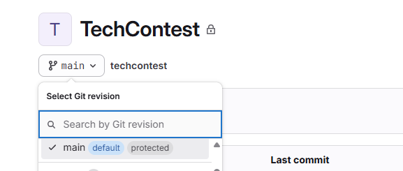

なお、Home画面の **「Follow the latest updates」** に表示される  
**「Joined project Administrator / TechContest」** からも、対象プロジェクトへアクセスできる。

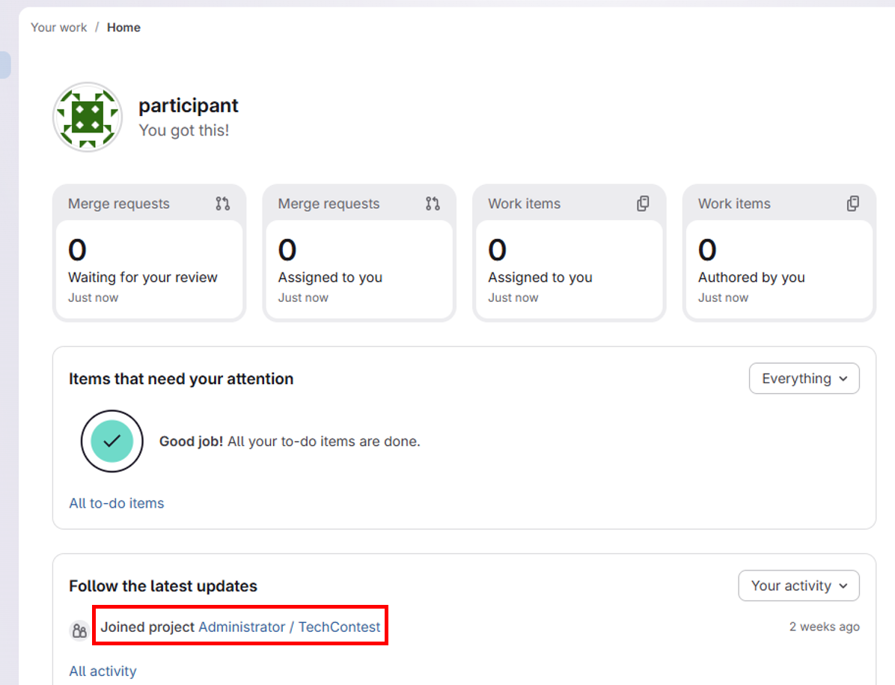

### 4.5 CI/CDパイプラインを実行する

> **実施者：チーム代表者1名**
>
> 初回のCI/CDパイプライン実行は、チーム内で重複して実行しないよう、代表者1名が実施してください。

> [!WARNING]
> CI/CD実行時にDocker Hubからイメージを取得する処理では、
> Docker Hub側のPullレート制限によりPipelineが失敗する場合があります。
>
> この制限は参加者が解決する課題ではありません。
> チーム間で開発環境に差が生じることを避けるため、
> 参加者側で個別にDocker Hubアカウントを作成し、
> Personal Access Token等を用いた認証済みPullは行わないでください。

1. 左ペインから「Build」→「Pipelines」を選択し、`New Pipeline` を選択する。

    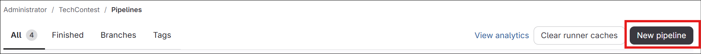

2. Run new Pipeline画面で `New Pipeline` を選択する。

    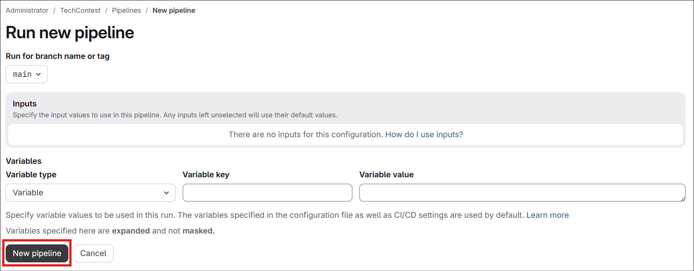

3. パイプラインの実行画面が表示されるため、`deploy-backend-validation: [order-info]` 以外のステータスが `Passed`（緑のチェック）になるまで待機する。

    > [!NOTE]
    > deployステージは明示的にRunボタンを押下する必要がある点に注意してください。

    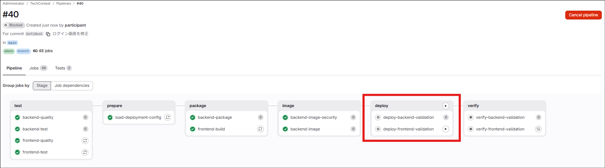

    > [!NOTE]
    > この時点では `deploy-backend-validation: [order-info]` は失敗しますが、意図的なものであり、後述の手順で解決するため問題ありません。

    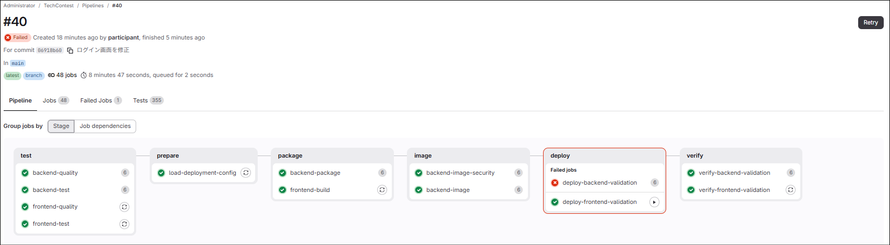

### 4.6 問題を確認する

1. エラーの原因を確認するため、`deploy-backend-validation: [order-info]` をクリックする。

    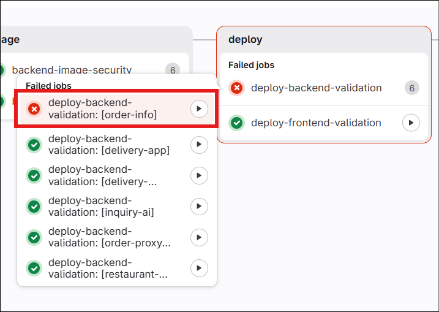

2. 表示された画面の末尾にエラーの詳細が出力されていることが確認できる。  

    ```
    An error occurred (InvalidParameterException) when calling 
    the UpdateService operation: The target group with targetGroupArn 
    arn:aws:elasticloadbalancing:ap-northeast-1:861097501323:targetgroup/
   eats-dev-order-tg/74a21fd4efe4210e does not have an associated load balancer.
    ```

    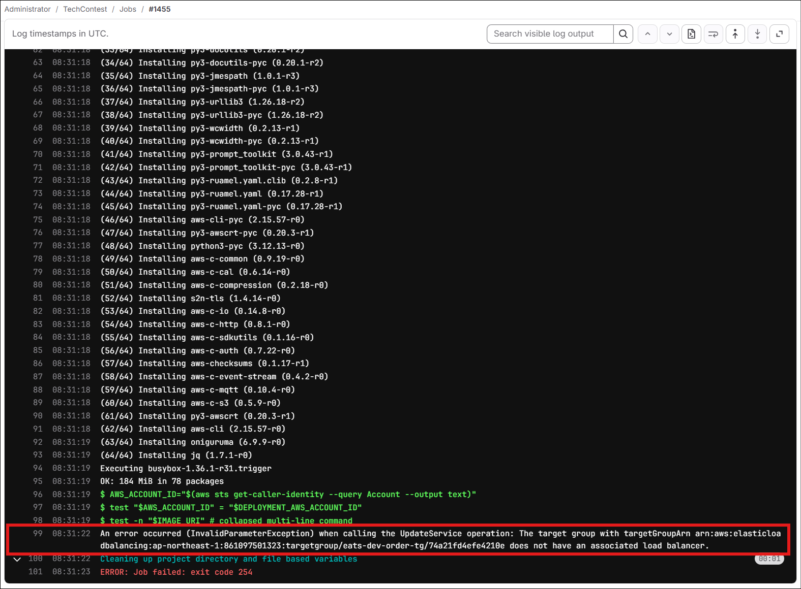

    これはターゲットグループに関連付いたロードバランサーが存在しないことを示す内容であることから、ロードバランサーの設定が適切でないことが推測できる。

### 4.7 問題を解決する

1. AWSマネジメントコンソール右上のリージョンが **アジアパシフィック（東京）`ap-northeast-1`** であることを確認する。

2. 「EC2」-「ロードバランサー」を開く。

    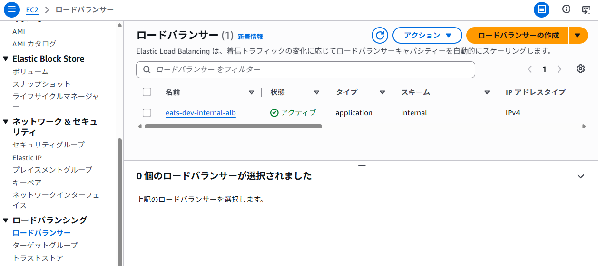

3. `eats-dev-internal-alb`ロードバランサーを選択し、リスナーとルール画面を開く。

    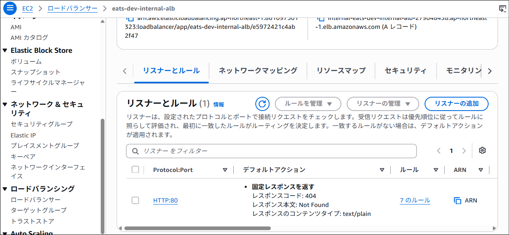

4. 優先度10のルール（条件が「パス (値) = /internal/orders* または /api/restaurants* または /api/orders*」）が、デフォルトで503を返すように設定されているため、これを修正する。

    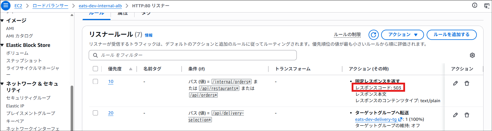

    > [!NOTE]
    > [システム仕様「7. Internal ALBのルーティング」](../01_specifications/01_specifications.md)
    > 優先度10（eats-dev-order-tg）の修正が必要であるという判断は、上記のシステム仕様の記載から行うことができます。

5. 優先度10のルールにチェックを入れ、「アクション」-「ルールの編集」を選択する。

    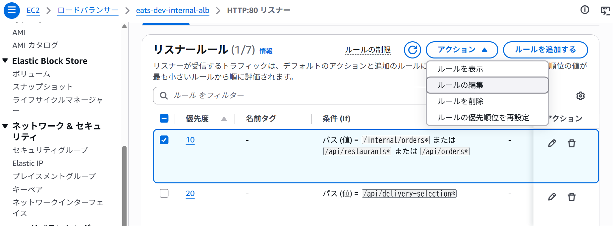

6. 「アクション」エリアで以下のように設定し、「次へ」をクリックする。
    - アクションのルーティングに `ターゲットグループへ転送` を選択
    - ターゲットグループに `eats-dev-order-tg` を選択
    - 重みを`1`に設定

    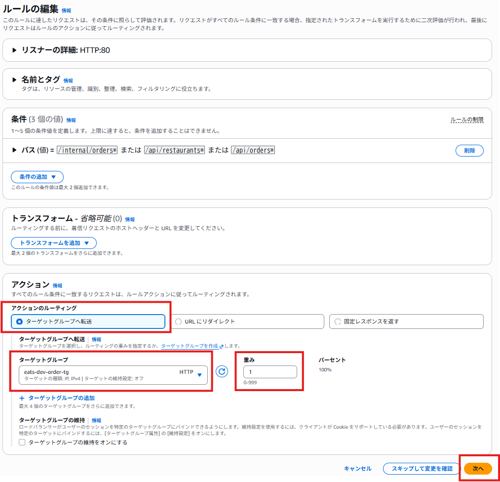

7. 「ルールの優先度を設定する」画面では、何もせずに次へボタンを押下する。

8. 「変更を確認」画面で、変更を保存する。

9. リスナールールが更新されていることを確認する。

    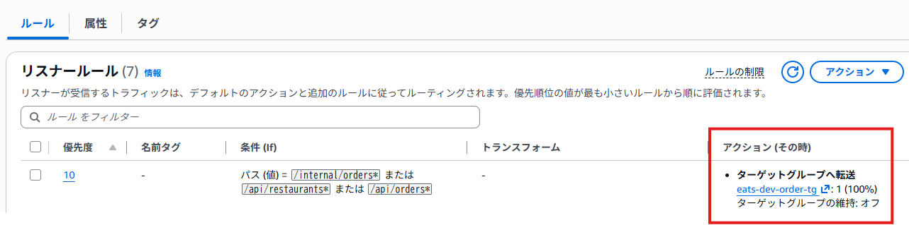

10. GitLabのPipeline画面を開き、1. 左ペインから「Build」→「Pipelines」を選択し、`New Pipeline` を選択する。

    

11. Run new Pipeline画面で `New Pipeline` を選択する。

    

12. パイプラインの実行画面が表示されるため、すべてのステータスが `Passed`（緑のチェック）になるまで待機する。

    > [!NOTE]
    > deployステージは明示的にRunボタンを押下する必要がある点に注意してください。

    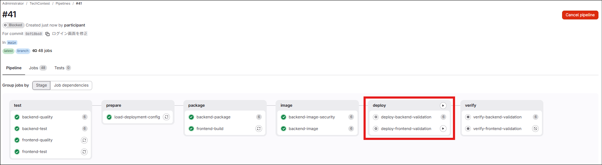

    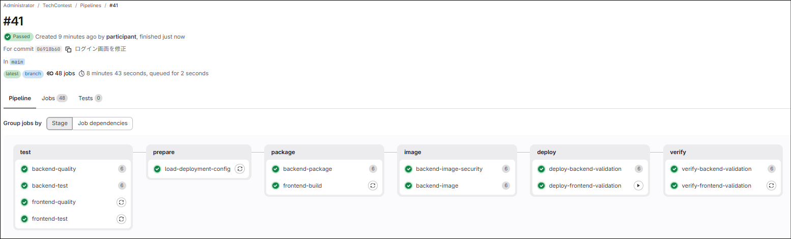

### 4.8 デプロイ結果を確認する

Deploy 完了後、変更がクラウド環境へ反映されたことを確認します。

#### ECS を確認する

1. Amazon ECS で `eats-dev-cluster` を開く。

   

2. **「サービス」** タブで、各サービスを確認する。次の観点を満たしていれば OK です。
   - タスクがすべて実行中（`2/2` 等）であること
   - タスクの **最終更新日時が新しくなっている**（今回の Deploy で更新された）こと

   

#### JISA Eatsの動作を確認する

1. `3.2 GitLabへのアクセス確認`で確認した`CloudFrontDomain`にブラウザからアクセスし、JISA Eatsのログイン画面に遷移する。
   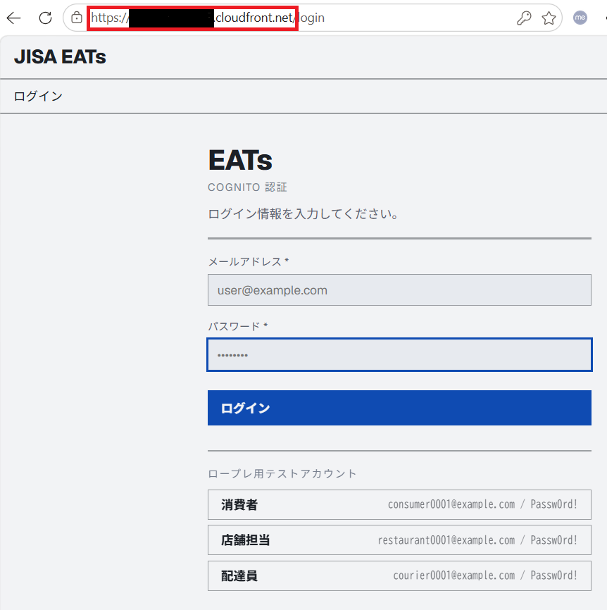

2. ログイン画面に表示されている消費者・店舗担当・配達員いずれかのアカウントを使用し、システムにログインできることを確認する。

### 4.9 エラーが発生した場合

参加者側で解消できない問題（GitLab 基盤・Runner・AWS リソースなど）が発生した場合は、作業環境の設定を変更せず、次の情報を確認・記録したうえで、運営にご連絡をお願いします。

- 対象プロジェクト / ブランチ
- Pipeline ID / ジョブ名
- 画面に表示されたエラーメッセージ / ジョブログ
- 発生時刻

代表的なケース:

| 症状 | 主な確認・対応 |
| :--- | :--- |
| Web IDE が開けない | GitLab 基盤側の問題の可能性。 |
| パイプラインが生成されない | Commit and push 済みか、最新コミットが表示されるかを確認。 |
| ジョブが `pending` のまま / ソース取得で失敗 | Runner・接続設定など基盤側の問題の可能性。 |
| test / build ジョブが失敗 | 自分の変更に起因する場合は Web IDE で修正して再 push。 |
| deploy ジョブが失敗 | 基盤側エラーの可能性。 |

---

> [!WARNING]
> 問題に取り組むにあたり、コードの修正が発生した場合は **Web IDE** を使用する必要があります。そのため、[付録E. コードの修正方法](#付録e-コードの修正方法) は **必ず目を通してください**。

## 付録

### 付録A. CI/CD構成の詳細

#### 手動 Deploy ジョブの種類と実行順序

通常のデプロイでは、RDSをスナップショットから作成する前提のため、DB移行処理を実行しません。`database-migrate-validation` は廃止されており、パイプラインに表示されないのは正常です。

変更内容に応じて表示されるジョブを、次の手順で実行・確認します。

1. `deploy-backend-validation`（表示される場合）: 変更対象サービスの **Play** を選択。
2. `deploy-frontend-validation`（表示される場合）: **Play** を選択。
3. `verify-backend-validation` / `verify-frontend-validation`: 対応する Deploy 後に自動実行されるジョブが `success` になることを確認。
4. `e2e-post-deploy`（表示される場合）: Verify 完了後に **Play** を選択し `success` を確認。

### 付録B. ブランチの作成方法

改善作業を分けて行う場合など、作業用ブランチを作成する手順です。

1. GitLab で `Administrator/TechContest` を開き、基準ブランチ（`main`）を選択する。

   

2. リポジトリ画面右上の **＋（Add to tree）> New branch** を選択する。

   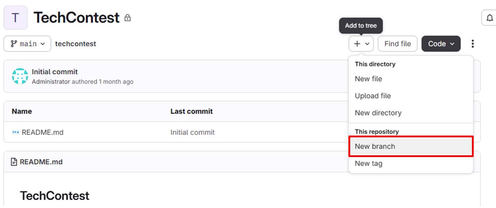

3. 任意の作業ブランチ名を入力し、Create from に `main` を指定して作成する（例: `feature/improve-frontend`）。

   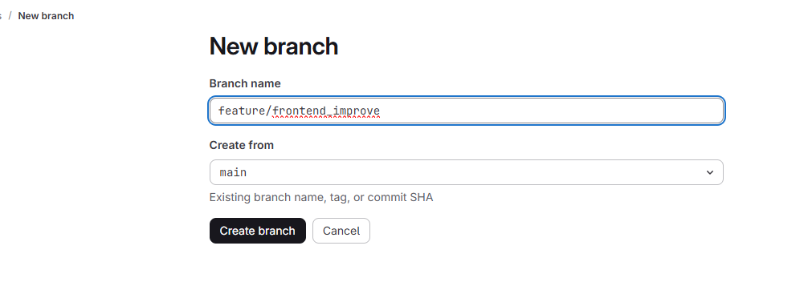

4. 作成したブランチへ切り替わっていることを確認する。

   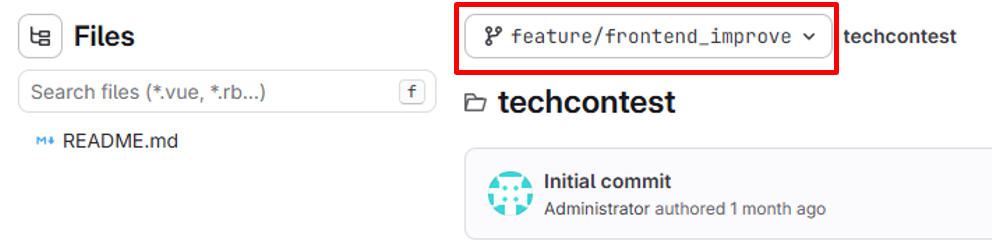

### 付録C. マージリクエスト（MR）の作成

作業ブランチの変更を `main` へ反映するため、変更を行ったメンバーが **マージリクエスト（MR）** を作成します。MR の **マージ（確認・反映）は別のメンバーが行う** ことを想定します（「付録D. チーム開発にて」を参照）。

1. 作業ブランチで初めて push すると、Merge Request（MR）の作成が案内されます。**「Create merge request」** を選択します。

   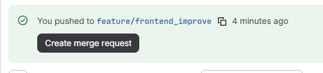

2. MR 作成画面で、マージ先（ターゲットブランチ）に **`main`** を選択し、変更内容が分かるタイトルを入力して作成します。

   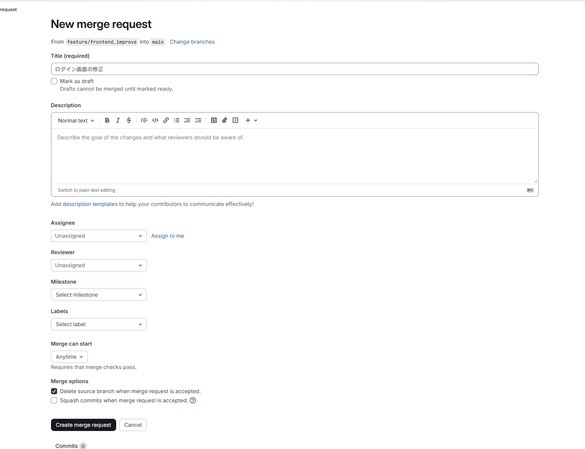

> [!NOTE]
> MR 概要画面の **「View latest app」** から、マージ前でもデプロイ済みの JISA Eats 環境を開いて確認できます。
>
> 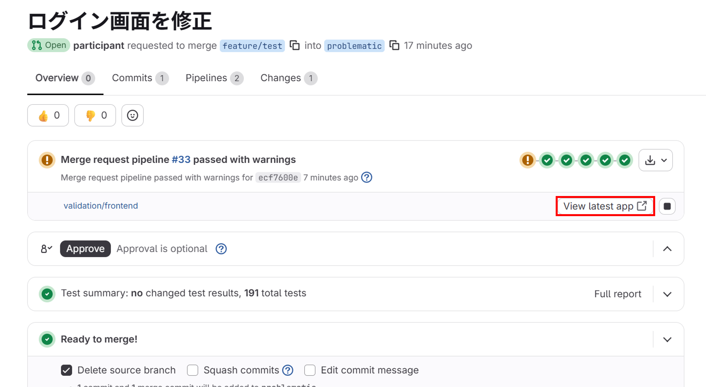

### 付録D. チーム開発にて（マージリクエストの承認とマージ）

チームで開発する場合、あるメンバーが作成した MR（付録C）を、**別のメンバーが確認・承認してマージ（反映）** します。修正者とマージ承認者を分けることで、変更内容を相互にレビューできます。

コードのマージと、CI/CDによるデプロイ・結果確認は区別して確認してください。デプロイ操作と結果確認は付録Eに記載しています。

#### メンバーの修正内容を確認・反映する

1. 対象の MR を開き、変更内容（差分）と、パイプラインが成功していることを確認する。
2. 「Ready to merge!」が表示されていることを確認し、**Merge** を選択する。

   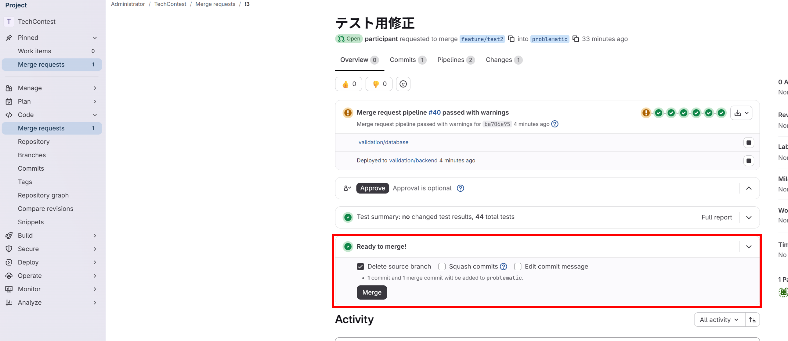

3. **Merged** と表示されていることを確認する。

   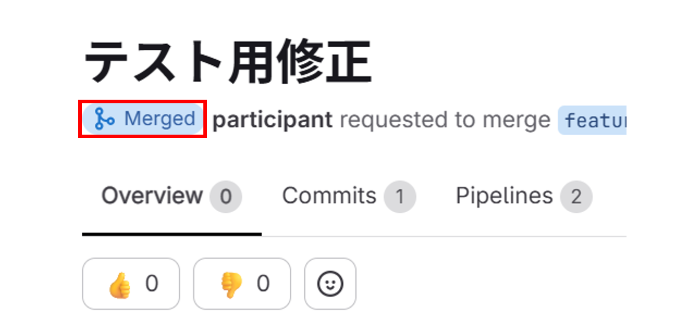

4. マージ後、`CloudFrontDomain` にアクセスし、画面で変更の反映状況を確認する。

   

### 付録E. コードの修正方法

> [!NOTE]
> チームで開発する場合は、`main` を直接編集せず、作業ブランチを作成してマージリクエストで反映することもあります。手順は「付録B. ブランチの作成方法」「付録C. マージリクエスト（MR）の作成」を参照してください。

参加者が修正する主なディレクトリは次のとおりです。

| 変更対象 | 主なディレクトリ |
| :--- | :--- |
| フロントエンド | `eats_system/apps/frontend/` |
| バックエンド | `eats_system/apps/backend/` 配下の各サービス |

参考例（ログイン画面の表記変更）:

1. `main` ブランチが選択されていることを確認し、**Code > Open in Web IDE** を選択する。

   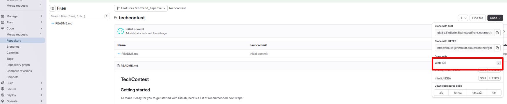

2. 変更対象ファイルを開き、コードを修正する（例: `LoginPage.tsx` の表記を変更）。

   

3. 左側の **Source Control** を開き、`Changes` に意図した変更ファイルだけが表示されていることを確認する。

   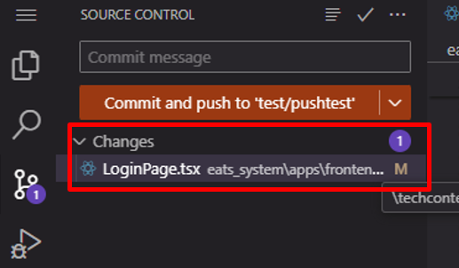

4. Web IDE の **Source Control** で **Commit message** を入力し、**Commit and push** を選択する。これを契機にパイプラインが自動的に起動します。

    > [!NOTE]
    > 既定のブランチ（main）を変更しようとしている旨の警告メッセージが表示されるため、**Continue** を選択して続行します。

   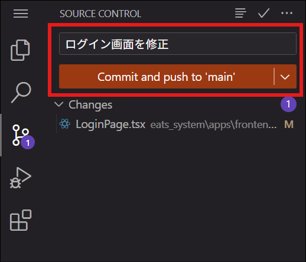

5. GitLab の **Build > Pipelines** を開き、push を契機に新しいパイプラインが **自動生成** されていることを確認する。

6. 自動ジョブ（テスト・ビルド等）が `pending` → `running` → `success` と進むことを確認する。

7. deploy の手前まで自動ジョブが完了したら、変更対象の **Deploy ジョブの Play** を選択する。この例ではフロントエンドの変更なので、`deploy-frontend-validation` を実行する。バックエンドの変更時は、`deploy-backend-validation` の変更対象サービスを実行する。

8. 対応する `verify-frontend-validation` / `verify-backend-validation` が自動実行され、`success` になることを確認する（目安: Deploy 実行から 5〜10 分程度）。`e2e-post-deploy` が表示される場合は、Verify 完了後に **Play** を選択し、`success` になることも確認する。

> [!NOTE]
> 手動 Deploy ジョブの種類と実行順序は「付録A. CI/CD構成の詳細」を参照してください。

#### システムのログイン画面で確認する

- ブラウザで JISA Eats のログイン画面（公開URL）へアクセスし、変更内容（例: 追加した文字列）が反映されていることを確認する。

   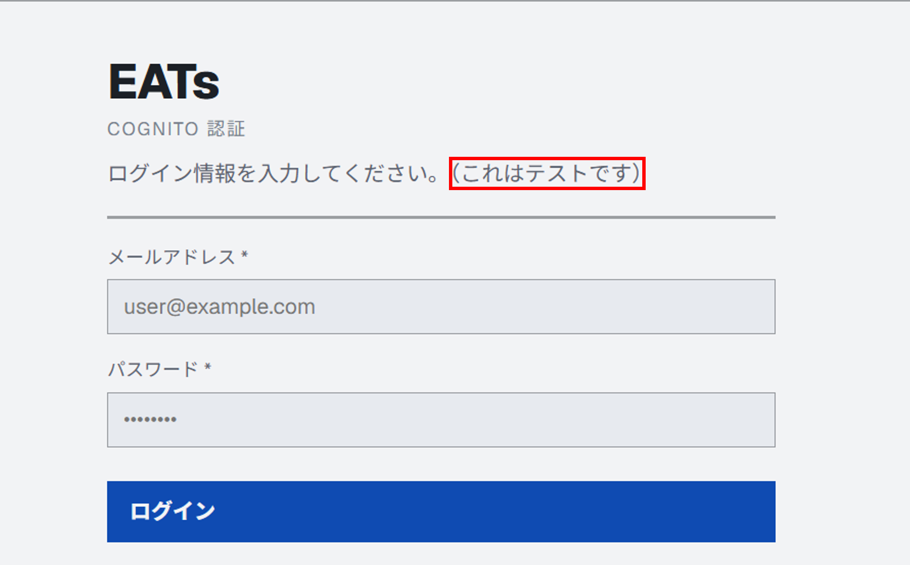

> [!NOTE]
> Merge Request を作成している場合は、MR 概要画面の **「View latest app」** からも同じ JISA Eats 環境を開けます（付録C 参照）。

### 付録F. インスタンスの夜間停止について

停止・再開の手順は、[インスタンスの停止・再開マニュアル（参加者向け）](./stop-instances-manual.md) を参照してください。

### 付録G. トラフィック試験前のデータ初期化

#### トラフィック試験前の初期化について

運営が実施するトラフィック試験では、試験開始前に各チーム環境のDB初期化処理を実行します。

初期化処理では、注文などのトランザクションデータに加え、店舗・商品・ユーザー情報等も初期化対象となります。

なお、参加者によるDBのテーブル追加や制約変更等によって、初期化処理が正常に完了しない場合があります。例えば、追加したテーブルから既存テーブルを参照する外部キー制約がある場合、初期化処理の `TRUNCATE` が失敗することがあります。

DB構成を変更した場合は、以下の「参加者による手動初期化」を参照し、データ保全や実行タイミングに注意したうえで、疑似トラフィックの採点前に初期化用Lambdaが正常に動作することを確認してください。コマンドの実行結果だけでなく、応答内容と初期化後のデータ状態も確認してください。

#### 参加者による手動初期化

参加者は、運営が提供する初期化用Lambdaを使用して、自チーム環境のデータを手動で初期化できます。

動作確認や検証のため、データを初期状態に戻したい場合に利用してください。

**実行前の注意事項**

- 初期化によって、注文データだけでなく店舗・商品・ユーザー情報等も初期化されます。必要なデータは事前に保全してください。
- チーム内で実行予定を共有し、ほかのメンバーの作業と重ならないことを確認してください。
- 運営による採点中や、採点・通常操作と重なる時間帯には実行しないでください。
- 初期化を実行する際は、必ず自チームのAWSアカウントであることを確認してください。

**実行手順**

1. AWSマネジメントコンソールに自チームのアカウントでログインします。
2. リージョンが東京（`ap-northeast-1`）であることを確認します。
3. CloudShellを開き、以下のコマンドを実行します。

   ```bash
   aws lambda invoke \
     --function-name jisa2026-lambda-initialize-for-traffic \
     --region ap-northeast-1 \
     --cli-read-timeout 900 \
     --cli-connect-timeout 60 \
     response_traffic.json && cat response_traffic.json
   ```

4. 実行後、`response_traffic.json` の応答内容とデータの状態を確認してください。

**エラーが発生した場合**

初期化処理でエラーが発生した場合は、再実行せず、エラー内容を添えて運営へご連絡ください。
なお、コマンドの実行が完了しただけでは、初期化処理が正常終了したとは限りません。応答内容を確認してください。

### 付録H. 疑似トラフィックのHTTP 401エラーについて

運営が実施する疑似トラフィックでは、一部のAPIリクエストでHTTP `401`エラーが発生した際に再認証が行われず、後続処理が進まなくなる場合があります。

本事象は運営側の疑似トラフィック生成処理に起因する既知の問題であり、参加者側で本事象への追加調査・改修を行う必要はありません。

ただし、すべてのHTTP `401`エラーが本事象に該当するわけではありません。本事象に該当するか判断できない場合は、発生日時や対象APIなど、確認可能な情報を添えて運営へお問い合わせください。


