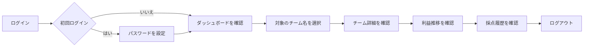
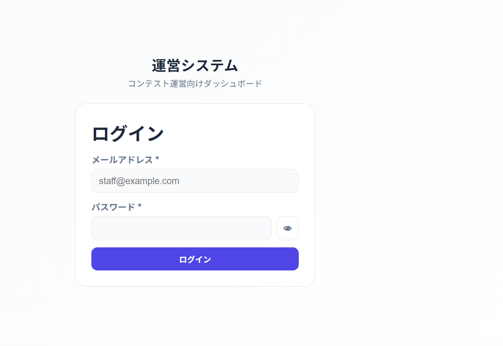
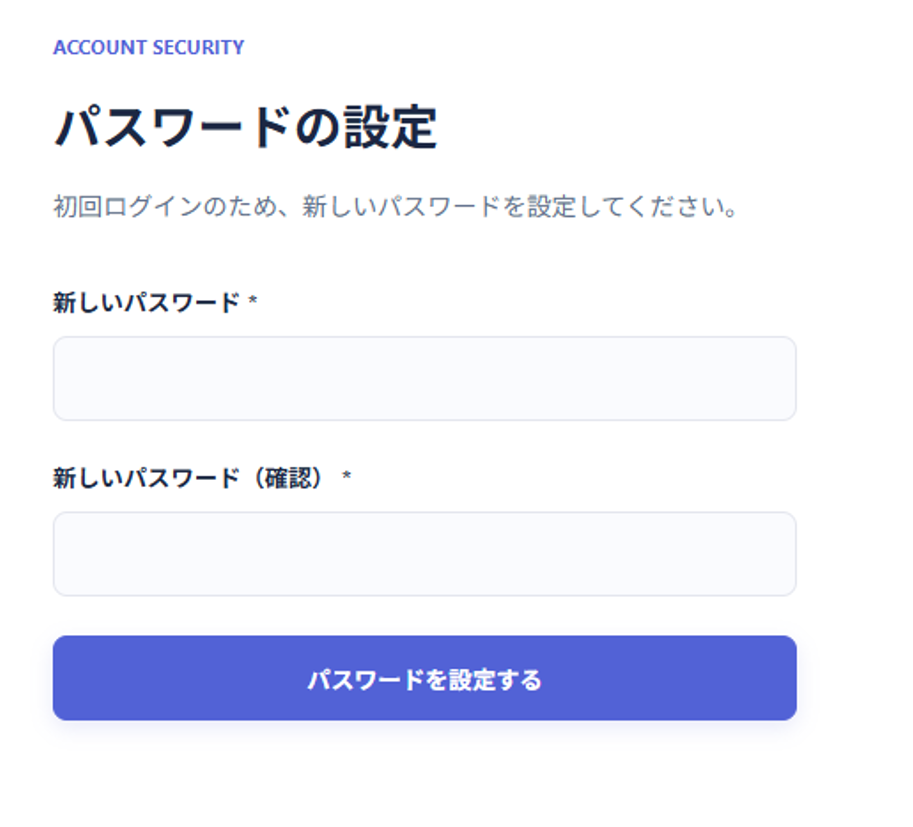
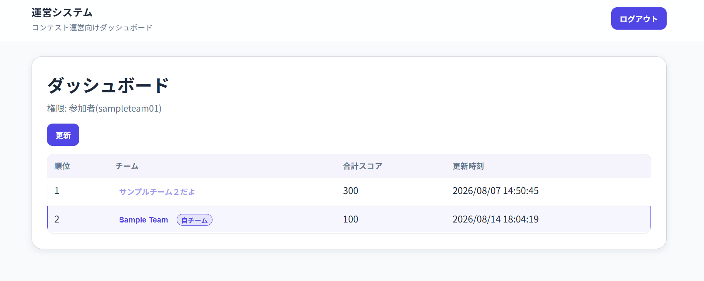
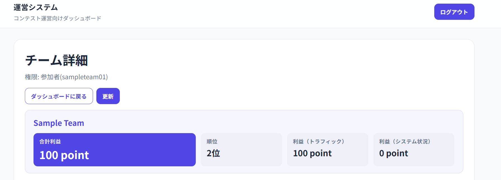
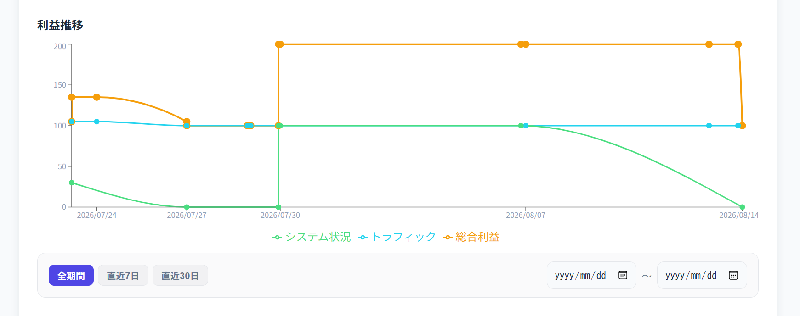
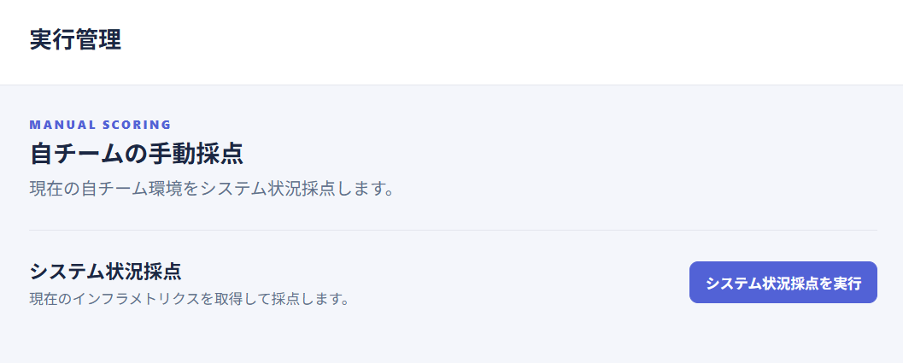
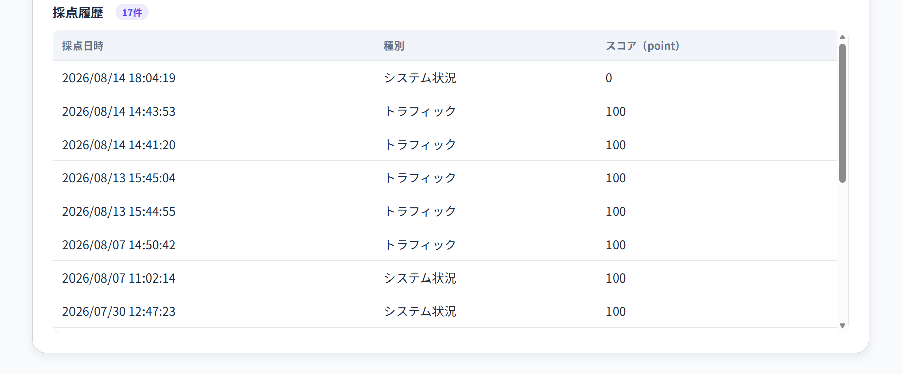

# 運営システム ユーザー操作手順書

## 1. 本書について

本書は、参加者が運営システムの Web 画面を操作し、チームの順位、スコア、利益推移、採点履歴を確認するための手順書です。画面に表示されるチーム名、順位、スコア、更新時刻等を確認してから操作してください。

パスワードは画面へ入力しますが、他人に共有したり、画面キャプチャに写したりしないでください。

### 1.1 対象ユーザー

本書の対象ユーザーは参加者ロールです。画面上では、`権限: 参加者(sampleteam01)` のように表示されます。

## 2. 全体の操作の流れ

操作は次の順に進みます。

## 3. 参加者の操作

### 3.1 ログインする

**使用するアカウント：** 参加者ロールのアカウント

### ログインアカウント

運営システムには、各チームに対応する以下のアカウントでログインします。

- メールアドレス：`tXX@example.com`
  - `XX` にはチーム番号を入力してください。
- パスワード：K81IF6RJHZa@

**アクセス先：** `https://feature-staff-system-appwithaws.dh727cahusw4z.amplifyapp.com/`

1. 運営システムの `ログイン` 画面を開きます。
2. `メールアドレス *` に、各チームに配布されたメールアドレスを入力します。
3. `パスワード *` に、各チームに配布されたパスワードを入力します。
4. 必要に応じて、パスワード入力欄右側のアイコンを使用してパスワードの表示・非表示を切り替えます。
5. 入力内容を確認し、`ログイン` を1回押します。

6. 初回ログインの場合は、`パスワードの設定` 画面が表示されます。

> **実施者：チーム代表者1名（現地参加メンバー）**
>
> 運営システムの初回パスワード設定は、チーム内で代表者1名が実施してください。

7. 以下のパスワードポリシーを満たす新しいパスワードを入力します。

   - 12文字以上
   - 英大文字を1文字以上含む
   - 英小文字を1文字以上含む
   - 数字を1文字以上含む
   - 記号を1文字以上含む

8. `新しいパスワード（確認）` に、同じパスワードを入力します。
9. `パスワードを設定する` を押します。

10. `ダッシュボード` が表示されることを確認します。

**補足：**  
2回目以降のログインでは、パスワード設定画面は表示されず、ログイン後にダッシュボードが表示されます。

### 3.2 ダッシュボードを確認する

**アクセス先：** `https://feature-staff-system-appwithaws.dh727cahusw4z.amplifyapp.com/`

1. `ダッシュボード` が表示されることを確認します。
2. 画面上部に表示される `権限` とログイン中のユーザーを確認します。
3. 最新の表示内容を確認する場合は `更新` を押します。
4. チーム一覧に表示される以下の内容を確認します。

- `順位`
- `チーム`
- `合計スコア`
- `更新時刻`

5. 詳細を確認する対象のチームを確認します。
6. 対象のチーム名を押します。
7. `チーム詳細` が表示されることを確認します。

### 3.3 チームの概要を確認する

**アクセス先：** `https://feature-staff-system-appwithaws.dh727cahusw4z.amplifyapp.com/`

1. `チーム詳細` が表示されることを確認します。
2. 画面上部に表示される `権限` とログイン中のユーザーを確認します。
3. 対象となるチーム名を確認します。
4. 最新の表示内容を確認する場合は `更新` を押します。
5. チームの概要に表示される以下の内容を確認します。

- `合計利益`
- `順位`
- `利益（トラフィック）`
- `利益（システム状況）`

6. ダッシュボードへ戻る場合は `ダッシュボードに戻る` を押します。

### 3.4 利益推移を確認する

**アクセス先：** `https://feature-staff-system-appwithaws.dh727cahusw4z.amplifyapp.com/`

`利益推移` はチーム詳細画面内の表示項目です。

1. `チーム詳細` 画面を下へスクロールし、`利益推移` を確認します。
2. グラフに表示される以下の項目を確認します。

- `システム状況`
- `トラフィック`
- `総合利益`

3. グラフの横軸の日付と縦軸のポイントを確認し、各項目の利益推移を確認します。
4. 表示期間を変更する場合は、以下のいずれかを選択します。

- `全期間`
- `直近7日`
- `直近30日`

5. 任意の期間を確認する場合は、開始日と終了日の日付入力欄を使用します。
6. 指定した期間に表示される利益推移を確認します。

### 3.5 システム状況採点を実行する

自チームの現在のシステム状況について、運営システムから手動で採点を実行します。

> [!IMPORTANT]
> システム状況採点を実行する前に、自チームのGitLab用EC2が起動しており、GitLabにアクセスできることを確認してください。起動・状態確認の手順は、[インスタンスの停止・再開マニュアル](./stop-instances-manual.md)の「1. 共通準備」「3. インスタンスを起動する」「4. 停止・起動状態を確認する」を参照してください。
>
> EC2の停止などによりGitLab APIで採点に必要な情報を取得できない場合、採点結果に影響することがあります。

1. 運営システムにログインします。
2. `実行管理` 画面を開きます。
3. `自チームの手動採点` が表示されていることを確認します。
4. `システム状況採点` の `システム状況採点を実行` を押します。
5. 採点処理が完了するまで待ちます。
6. 採点完了後、チーム詳細画面の `採点履歴` で採点結果を確認します。

採点結果が意図せず変化した場合は、チーム名、採点日時、変化前後のスコア、採点時のGitLab用EC2の起動状態・GitLabへのアクセス可否、確認できる範囲のエラー情報を添えて運営へお問い合わせください。

### 3.6 採点履歴を確認する

**アクセス先：** `https://feature-staff-system-appwithaws.dh727cahusw4z.amplifyapp.com/`

`採点履歴` はチーム詳細画面内の表示項目です。

1. `チーム詳細` 画面を下へスクロールし、`採点履歴` を確認します。
2. `採点履歴` の見出し横に表示される件数を確認します。
3. 一覧に表示される以下の内容を確認します。

- `採点日時`
- `種別`
- `スコア（point）`

4. `種別` に表示される以下の採点対象を確認します。

- `システム状況`
- `トラフィック`

5. 履歴が表示領域に収まらない場合は、採点履歴の表示領域をスクロールして過去の履歴を確認します。

> [!NOTE]
> 採点履歴が更新された後、ランキング画面やチーム詳細画面上部のスコア表示へ反映されるまで、最大5分程度かかる場合があります。
> 採点履歴とスコア表示が一致しない場合は、しばらく待ってから `更新` を押し、再度表示を確認してください。

### 3.7 ログアウトする

1. 操作を終了する場合は、画面右上の `ログアウト` を押します。
2. `ログイン` 画面が表示されることを確認します。

## 4. 利用時の注意事項

- 最新の表示内容を確認する場合は `更新` を使用してください。
- 順位やスコアを確認する際は、`更新時刻` もあわせて確認してください。
- `利益推移` を確認する際は、現在選択されている表示期間を確認してください。
- `採点履歴` は表示領域をスクロールして過去の履歴を確認してください。
- パスワードは他人に共有したり、画面キャプチャに写したりしないでください。
