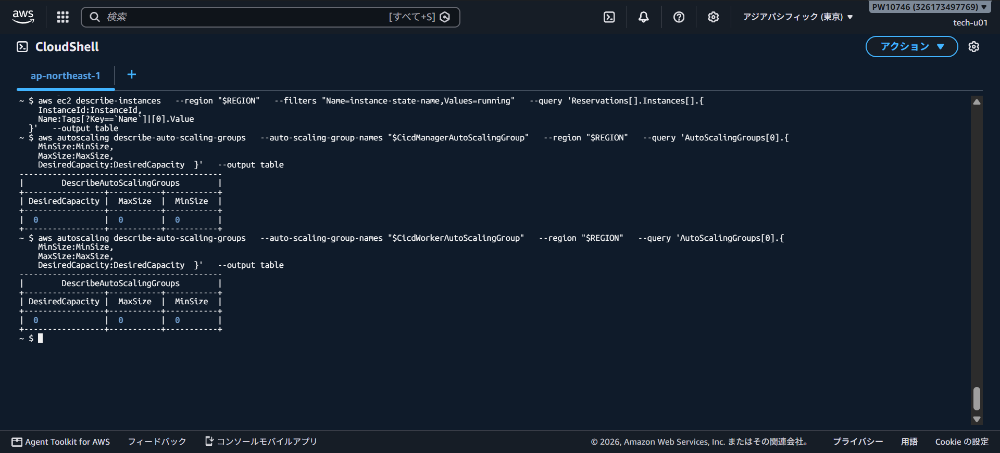
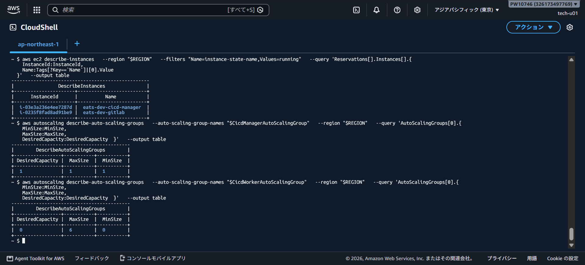

# インスタンスの停止・再開マニュアル（参加者向け）

夜間など、作業を行わない時間帯のコストを抑えるため、自チームの **GitLab・CI/CD 用インスタンス**を停止してください。

停止時・再開時の動作は以下のとおりです。

| 対象            | 停止時        | 再開時                       |
| :------------ | :--------- | :------------------------ |
| GitLab        | EC2を停止     | 同じEC2を起動                  |
| CI/CD Manager | EC2を終了（削除） | Auto Scalingにより新規作成       |
| CI/CD Worker  | EC2を終了（削除） | 必要に応じてAuto Scalingにより新規作成 |

> [!WARNING]
> **停止中は、チーム全員が GitLab・CI/CD を利用できません。**
>
> 停止する前に、チーム内で作業終了を確認し、以下を必ず実施してください。
>
> * 作業中の変更を保存・pushする
> * 実行中のパイプラインがないことを確認する
> * 他のチームメンバーがGitLab・CI/CDを利用していないことを確認する

> [!IMPORTANT]
> **運営による採点が予定されている時間帯は、採点に必要な環境を停止しないでください。**
>
> 運営から採点日時や環境の起動について案内があった場合は、その案内に従い、採点開始前にGitLab用EC2を起動してGitLabへのアクセスを確認し、指定された期間は稼働状態を維持してください。
>
> GitLabが停止しているなどの理由で必要な情報を取得できない場合、システム状況採点の結果に影響する可能性があります。
>
> GitLab用EC2の起動方法は本書の「3. インスタンスを起動する」、起動状態の確認方法は「4. 停止・起動状態を確認する」を参照してください。

---

## 1. 共通準備

**停止・再開のどちらの場合も、最初に実施してください。**

### 1-1. AWSへログインする

配布された自チームの認証情報とMFAを使用して、AWSマネジメントコンソールにログインします。

初回設定が完了していない場合は、[環境設定マニュアル](./setup-manual.md) の第1・2章を実施してください。

### 1-2. CloudShellを開く

以下を確認してから、AWSマネジメントコンソール上部の検索窓から **CloudShell** と入力し CloudShell を開きます。

* AWSアカウント：自チームのアカウント
* リージョン：**東京（`ap-northeast-1`）**

### 1-3. 対象リソースを取得する

CloudShellに以下を貼り付けて実行します。

```sh
STACK_NAME=tech-contest
REGION=ap-northeast-1

GitLabInstance=$(aws cloudformation list-stack-resources \
  --stack-name "$STACK_NAME" \
  --region "$REGION" \
  --query "StackResourceSummaries[?LogicalResourceId=='GitLabInstance'].PhysicalResourceId" \
  --output text)

CicdManagerAutoScalingGroup=$(aws cloudformation list-stack-resources \
  --stack-name "$STACK_NAME" \
  --region "$REGION" \
  --query "StackResourceSummaries[?LogicalResourceId=='CicdManagerAutoScalingGroup'].PhysicalResourceId" \
  --output text)

CicdWorkerAutoScalingGroup=$(aws cloudformation list-stack-resources \
  --stack-name "$STACK_NAME" \
  --region "$REGION" \
  --query "StackResourceSummaries[?LogicalResourceId=='CicdWorkerAutoScalingGroup'].PhysicalResourceId" \
  --output text)
```

以降の操作も、**同じCloudShellで実行してください。**

CloudShellを閉じたり開き直したりした場合は、上記コマンドを再度実行してください。

> [!IMPORTANT]
> コマンド実行時にエラーが表示された場合は、以降の操作を行わず、**表示されたエラーメッセージを添えて運営へ連絡してください。**

停止する場合は「2. インスタンスを停止する」、再開する場合は「3. インスタンスを起動する」へ進みます。

---

## 2. インスタンスを停止する

### 2-1. 停止コマンドを実行する
> [!IMPORTANT]
> CI/CD実行中および実行直後は、CI/CD Workerの増減が発生している場合があります。Workerの増減が落ち着いてから、以下の停止操作を実施してください。

CloudShellで以下を実行します。

```sh
# GitLabを停止
aws ec2 stop-instances \
  --region "$REGION" \
  --instance-ids "$GitLabInstance"

# CI/CD Managerを停止
aws autoscaling update-auto-scaling-group \
  --region "$REGION" \
  --auto-scaling-group-name "$CicdManagerAutoScalingGroup" \
  --min-size 0 \
  --max-size 0 \
  --desired-capacity 0

# CI/CD Workerを停止
aws autoscaling update-auto-scaling-group \
  --region "$REGION" \
  --auto-scaling-group-name "$CicdWorkerAutoScalingGroup" \
  --min-size 0 \
  --max-size 0 \
  --desired-capacity 0

# Workerのスケールイン保護を解除
WORKER_INSTANCES=$(aws autoscaling describe-auto-scaling-groups \
  --region "$REGION" \
  --auto-scaling-group-names "$CicdWorkerAutoScalingGroup" \
  --query 'AutoScalingGroups[0].Instances[*].InstanceId' \
  --output text)

if [ -n "$WORKER_INSTANCES" ]; then
  aws autoscaling set-instance-protection \
    --region "$REGION" \
    --auto-scaling-group-name "$CicdWorkerAutoScalingGroup" \
    --instance-ids $WORKER_INSTANCES \
    --no-protected-from-scale-in
fi
```

GitLabは**停止（stopped）**します。

Manager・WorkerはAuto Scalingの台数を0にするため、**終了（terminated）**します。

> [!IMPORTANT]
> "The instance i-xxxxxx is not part of Auto Scaling group xxxxx" といったエラーが発生した場合は、Workerの増減が落ち着くまで少し待ってから上記の停止コマンドを再実行してください。
再実行してもエラーが解消しない場合、またはその他のエラーが発生した場合は、**表示されたエラーメッセージを添えて運営へ連絡してください。**

### 2-2. 停止を確認する

数分待ってから、「4. 停止・起動状態を確認する」へ進みます。

---

## 3. インスタンスを起動する

### 3-1. 起動コマンドを実行する

CloudShellで以下を実行します。

```sh
# GitLabを起動
aws ec2 start-instances \
  --region "$REGION" \
  --instance-ids "$GitLabInstance"

# CI/CD Managerを起動
aws autoscaling update-auto-scaling-group \
  --region "$REGION" \
  --auto-scaling-group-name "$CicdManagerAutoScalingGroup" \
  --min-size 1 \
  --max-size 1 \
  --desired-capacity 1

# CI/CD Workerを通常設定に戻す
aws autoscaling update-auto-scaling-group \
  --region "$REGION" \
  --auto-scaling-group-name "$CicdWorkerAutoScalingGroup" \
  --min-size 0 \
  --max-size 6 \
  --desired-capacity 0
```

ManagerはAuto Scalingによって新しいEC2が作成されます。

Workerは `DesiredCapacity=0` で再開し、必要に応じて自動的に起動します。

### 3-2. 起動を確認する

数分待ってから、「4. 停止・起動状態を確認する」へ進みます。

---

## 4. 停止・起動状態を確認する

操作後、同じCloudShellで以下を実行します。

### 4-1. 実行中のEC2を確認する

```sh
aws ec2 describe-instances \
  --region "$REGION" \
  --filters "Name=instance-state-name,Values=running" \
  --query 'Reservations[].Instances[].{
    InstanceId:InstanceId,
    Name:Tags[?Key==`Name`]|[0].Value
  }' \
  --output table
```

### 4-2. ManagerのAuto Scaling設定を確認する

```sh
aws autoscaling describe-auto-scaling-groups \
  --auto-scaling-group-names "$CicdManagerAutoScalingGroup" \
  --region "$REGION" \
  --query 'AutoScalingGroups[0].{
    MinSize:MinSize,
    MaxSize:MaxSize,
    DesiredCapacity:DesiredCapacity
  }' \
  --output table
```

### 4-3. WorkerのAuto Scaling設定を確認する

```sh
aws autoscaling describe-auto-scaling-groups \
  --auto-scaling-group-names "$CicdWorkerAutoScalingGroup" \
  --region "$REGION" \
  --query 'AutoScalingGroups[0].{
    MinSize:MinSize,
    MaxSize:MaxSize,
    DesiredCapacity:DesiredCapacity
  }' \
  --output table
```

以下の状態になっていることを確認してください。

台数は **`MinSize / MaxSize / DesiredCapacity`** の順です。

| 確認対象    | 停止後                          | 再開後                  |
| :------ | :--------------------------- | :------------------- |
| 実行中のEC2 | GitLab・Manager・Workerが表示されない | GitLab・Managerが表示される |
| Manager | `0 / 0 / 0`                  | `1 / 1 / 1`          |
| Worker  | `0 / 0 / 0`                  | `0 / 6 / 0` ※        |

※ Workerは必要に応じて自動起動するため、その後 `0 / 6 / 1` などに変化する場合があります。

停止操作後の確認コマンドの出力例



起動操作後の確認コマンドの出力例



---

## 停止・再開の流れ

**作業を終了するとき**

`チーム内で終了確認` → `変更をpush` → `パイプライン停止確認` → `共通準備` → `停止コマンド実行` → `停止確認`

**作業を再開するとき**

`共通準備` → `起動コマンド実行` → `起動確認` → `GitLabログイン確認` → `作業再開`
