# JISA Eats ユーザー操作手順書

## 1. 本書について

本書は、消費者、店舗従業員、配達員が JISA Eats の Web 画面を操作して、注文から受け取り完了までを進めるための手順書です。画面に表示される注文 ID と状態を確認してから操作してください。

パスワードは画面へ入力しますが、他人に共有したり、画面キャプチャに写したりしないでください。

### 1-1. 本書が対象とするシナリオ

本書では、疑似トラフィックの業務操作のうち、利用者がブラウザで実施する次の範囲を説明します。

| 利用者 | 本書で対象とする主な操作 |
|---|---|
| 消費者 | ログイン、店舗・商品の選択、注文内容と配達予定の確認、注文の確定、注文状況の確認、受け取り完了の登録 |
| 店舗従業員 | ログイン、注文の確認・承諾、調理完了の登録 |
| 配達員 | ログイン、配達依頼の確認・受諾、商品受け取り完了の登録、配達完了の登録 |

対象範囲は、消費者の注文開始から、店舗従業員と配達員の処理を経て、消費者が受け取り完了を登録するまでです。ベンチ内部の処理、負荷制御、評価ウィンドウ、API の直接操作は本書の対象外です。

### 1-2. 実施前の前提条件

実施前に、次の事項を確認してください。

1. 各ロールのログインに使用するユーザー情報を確認できること
2. ユーザー名・メールアドレス・パスワード等を管理している所定の資料へアクセスできること
3. JISA Eats のサーバと対象環境が起動していること
4. 操作に必要なマスターデータと初期データがセットされていること
5. 各チームの JISA Eats サイト URL を確認できること
6. 使用するブラウザから対象サイトへアクセスできること

各チームの JISA Eats サイト URL はチームごとに異なります。
確認方法は、[環境設定手順書](./setup-manual.md)を参照してください。

### 1-3. 使用するアカウントのロール

ログイン時は、操作する利用者に対応するロールのアカウントを使用してください。

| 利用者 | 使用するアカウントのロール | 主な操作 |
|---|---|---|
| 消費者 | `consumer` | 店舗・商品選択、注文、注文状況確認、受け取り完了 |
| 店舗従業員 | `restaurant` | 注文確認、承諾、調理完了 |
| 配達員 | `courier` | 配達依頼確認、受諾、商品受け取り、配達完了 |

> **重要:** 各チームの JISA Eats 環境には、以下のユーザー名体系の利用者アカウントが用意されています。
> 本手順では、運営から案内されたアカウントの認証情報を使用してください。
>
> - 消費者：`consumer0001@example.com` ～ `consumer1000@example.com`
> - 店舗従業員：`restaurant0001@example.com` ～ `restaurant0150@example.com`
> - 配達員：`courier0001@example.com` ～ `courier0500@example.com`

## 2. 全体の操作の流れ

1 件の注文は、次の順に進みます。図は利用者が行う操作の順序を示したもので、内部 API やベンチ内部の処理は省略しています。

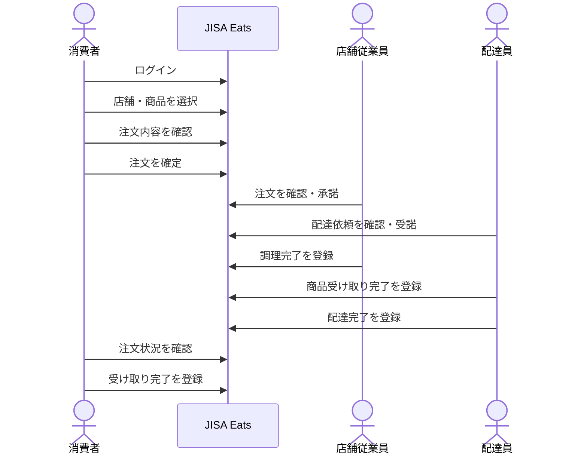

画面上の状態は、`店舗受付中`、`店舗受付完了`、`配達員選定中`、`配達員選定完了`、`調理完了`、`配達中`、`完了`、`受け取り完了` の順に表示されます。

### 2.1 本手順の実施順序

1件の注文を手動で確認する場合は、以下の順序で各章の手順を実施してください。
同じ注文IDを各ロールの画面で確認しながら操作します。

1. 消費者：3.1 ～ 3.5（ログイン ～ 注文確定）
2. 店舗従業員：4.1 ～ 4.3（ログイン ～ 注文承諾）
3. 配達員：5.1 ～ 5.3（ログイン ～ 配達依頼受諾）
4. 店舗従業員：4.4（調理完了）
5. 配達員：5.4 ～ 5.5（商品受け取り ～ 配達完了）
6. 消費者：3.6 ～ 3.7（注文状況確認 ～ 受け取り完了）

### 2.2 主な画面一覧

| 画面 ID | 画面名 | URL |
|---|---|---|
| `SCR-001` | ログイン画面 | `<ベースURL>/login` |
| `SCR-002` | 店舗を探す画面 | `<ベースURL>/consumer/top` |
| `SCR-003` | 商品一覧画面 | `<ベースURL>/consumer/products` |
| `SCR-004` | 注文確認画面 | `<ベースURL>/consumer/confirm` |
| `SCR-005` | 注文完了画面 | `<ベースURL>/consumer/complete` |
| `SCR-006` | 注文状況画面 | `<ベースURL>/consumer/status` |
| `SCR-007` | 飲食店向け注文確認画面 | `<ベースURL>/restaurant/orders` |
| `SCR-008` | 配達者向け配達依頼確認画面 | `<ベースURL>/courier/orders` |
| `SCR-009` | AI問い合わせチャット画面 | `<ベースURL>/ai/inquiry`（疑似トラフィックの対象外） |

## 3. 消費者の操作

### 3.1 ログインする

消費者アカウントは `consumer0001@example.com` ～ `consumer1000@example.com` が用意されています。
操作に使用するアカウントを確認してログインしてください。

パスワード：`Passw0rd!`

**アクセス先：** `<ベースURL>/login`

1. `ログイン` 画面を開きます。
2. 操作に使用する消費者用アカウントを確認します。
3. `メールアドレス *` に使用する消費者アカウントのメールアドレスを入力し、`パスワード *` に `Passw0rd!` を入力します。
4. `ログイン` を 1 回押します。
5. `送信中...` が表示されている間は、再度 `ログイン` を押さずに待ちます。
6. `店舗を探す` 画面（SCR-002）が表示されることを確認します。
7. 「メールアドレスまたはユーザー ID とパスワードを入力してください。」または「認証情報が一致しません。入力内容を確認して再度ログインしてください。」と表示された場合は、入力内容を確認してから操作します。

### 3.2 店舗を選択する

**アクセス先：** `<ベースURL>/consumer/top`

1. `店舗を探す` 画面（SCR-002）が表示されることを確認します。
2. 必要に応じて、`店舗を検索` に**店舗名・住所・商品名**を入力し、`検索` を押します。
3. `店舗一覧` から利用する店舗を探します。検索した場合は、検索条件に一致する店舗が表示されます。読み込み中は `読み込み中...` と表示されます。
4. 店舗名と `営業中` を確認します。
5. 利用する店舗の `選択` を 1 回押します。
6. `商品一覧画面`（SCR-003）が表示されることを確認します。

`営業終了` の店舗は選択できません。`利用可能な店舗がありません。` と表示された場合は、利用できる店舗が表示されるまで注文を進められません。

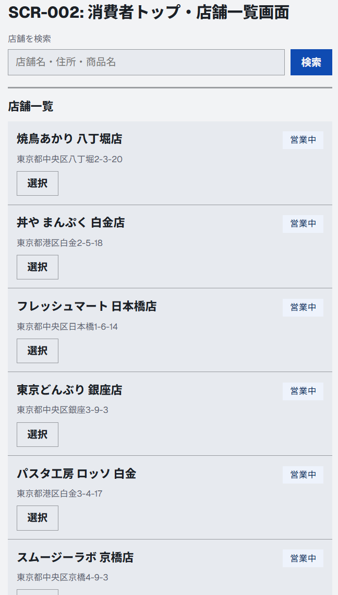

### 3.3 商品を選択する

**アクセス先：** `<ベースURL>/consumer/products`

1. `商品一覧画面`（SCR-003）が表示されることを確認します。
2. 商品名、`価格: ¥...`、`在庫あり` または `在庫なし` を確認します。
3. 購入する商品の `カートに追加` を押します。`カートに追加` は在庫がある商品にだけ表示されます。
4. 複数の商品を購入する場合は、商品ごとに `カートに追加` を押します。
5. `カート内容` で、商品名、単価、数量、小計を確認します。
6. 数量を変更する場合は、商品の数値入力欄へ希望する数量を入力します。`1` 未満を入力すると、その商品はカートから削除されます。
7. 商品をカートから外す場合は `削除` を押します。
8. カートに 1 品目以上あることを確認し、`注文確認画面へ` を 1 回押します。
9. `注文確認画面`（SCR-004）が表示されることを確認します。

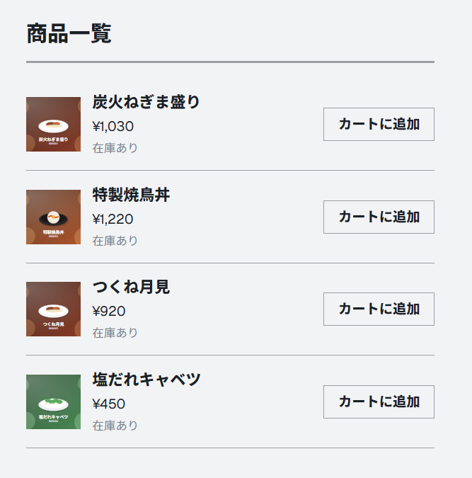
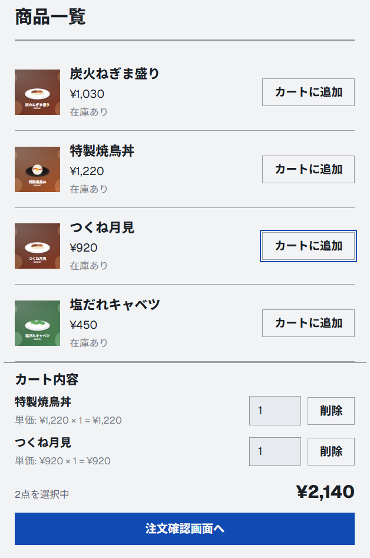

### 3.4 注文内容・配達予定を確認する

**アクセス先：** `<ベースURL>/consumer/confirm`

1. `注文確認画面`（SCR-004）が表示されることを確認します。
2. `既定配達先住所` と「ログイン利用者の既定配達先を使用します（変更不可）。」を確認します。
3. `支払い方法 *` で `クレジットカード` または `現金` を選択します。
4. `配達予測時間を確認` を押します。
5. `HH:MM頃にお届け予定です` が表示された場合は、配達予定を確認します。
6. 「配達予測時間: 取得不可」と表示された場合も、注文を続けることはできます。

`配達予測を計算中...` と表示されている間は、`配達予測時間を確認` を繰り返し押さないでください。

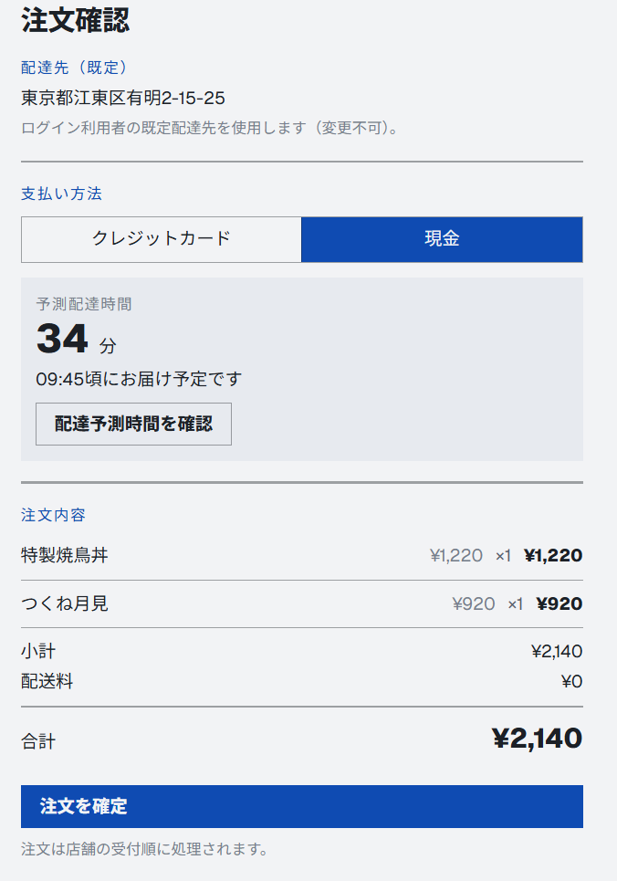

### 3.5 注文を確定する

**アクセス先：** `<ベースURL>/consumer/confirm`

1. `注文確認画面`（SCR-004）で支払い方法と配達予定を確認します。
2. `注文を確定` を 1 回だけ押します。
3. `処理中...` と表示されている間は、`注文を確定` を繰り返し押さずに待ちます。
4. `注文完了画面`（SCR-005）が表示されたら、`注文が完了しました` を確認します。
5. `注文ID: ...` を確認します。
6. `注文内容` の `注文状態:`、`配達先住所:`、`支払い方法:`、`予測配達時間:`、商品表の `商品名`、`単価`、`数量`、`小計`、`合計` を確認します。
7. `注文状況を確認` を 1 回押します。
8. `注文状況画面`（SCR-006）が表示されることを確認します。
9. 対象注文の `注文ID` と `店舗メールアドレス` を確認します。
10. 以降の店舗従業員の操作では、ここで確認した店舗メールアドレスを使用します。

「注文IDが取得できませんでした。」または「注文情報を取得できませんでした。」と表示された場合は、同じ注文を続けて確定せず、画面の表示を確認してください。

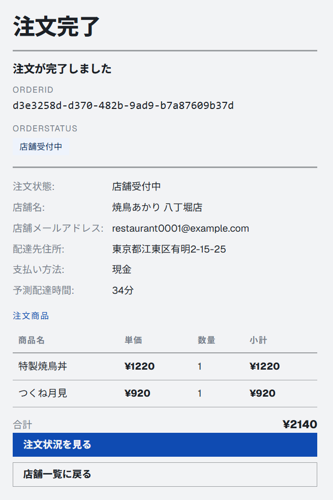

### 3.6 注文状況を確認する

**アクセス先：** `<ベースURL>/consumer/status`

1. `注文状況画面`（SCR-006）が表示されることを確認します。
2. 最新の状態を確認する場合は `再読み込み` を押します。
3. 読み込み中は `読み込み中...` と表示されるため、表示が終わるまで待ちます。
4. 対象の `注文ID:`、`状態:`、`注文日時:` を確認します。
5. 状態が `完了` になるまで、必要に応じて `再読み込み` で最新の状態を確認します。

注文がない場合は `注文がありません。` と表示されます。

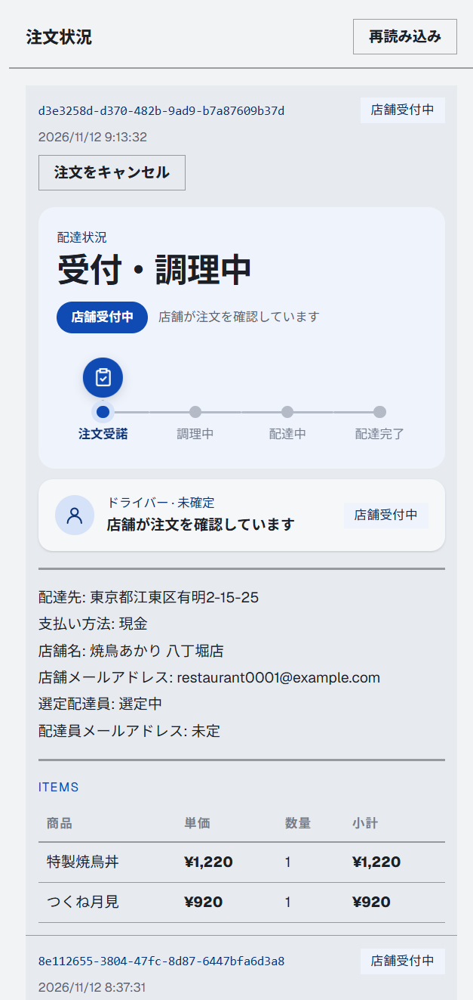

### 3.7 受け取りを完了する

**アクセス先：** `<ベースURL>/consumer/status`

1. `注文状況画面`（SCR-006）で対象の `注文ID:` と `状態: 完了` を確認します。
2. 対象行の `受け取り完了` を 1 回だけ押します。
3. `更新中...` と表示されている間は、同じ `受け取り完了` を繰り返し押さずに待ちます。
4. 表示が更新された後、対象注文の `状態: 受け取り完了` を確認します。

`受け取り完了` は、状態が `完了` の注文にだけ表示されます。

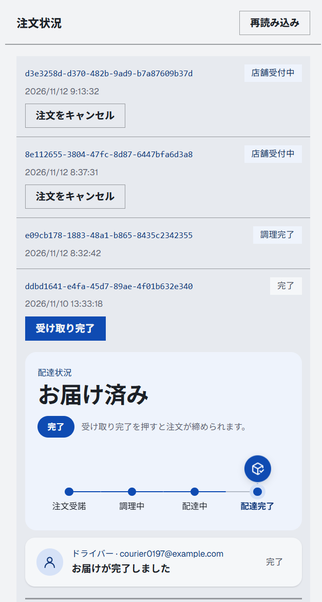

### 3.8 AI問い合わせチャットを利用する

**アクセス先：** `<ベースURL>/ai/inquiry`（疑似トラフィックの対象外）

1. `AI問い合わせチャット画面`（SCR-009）を開きます。
2. 「AI 回答は参考情報です。確認責任はプロダクトオーナーおよび業務責任者が持ちます。」と表示されていることを確認します。
3. `問い合わせ文 *` に確認したい内容を入力します。
4. 入力内容を確認し、`送信` を 1 回押します。
5. AI の回答が表示されるまで待ちます。
6. `あなた` に入力した問い合わせ内容が表示されていることを確認します。
7. `AI` に表示された回答内容を確認します。
8. 続けて問い合わせる場合は、`問い合わせ文 *` に新しい内容を入力し、再度 `送信` を押します。

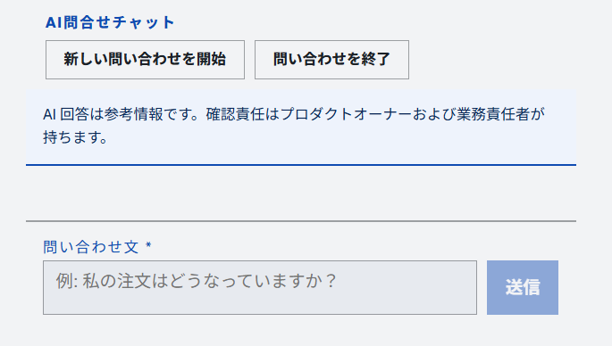

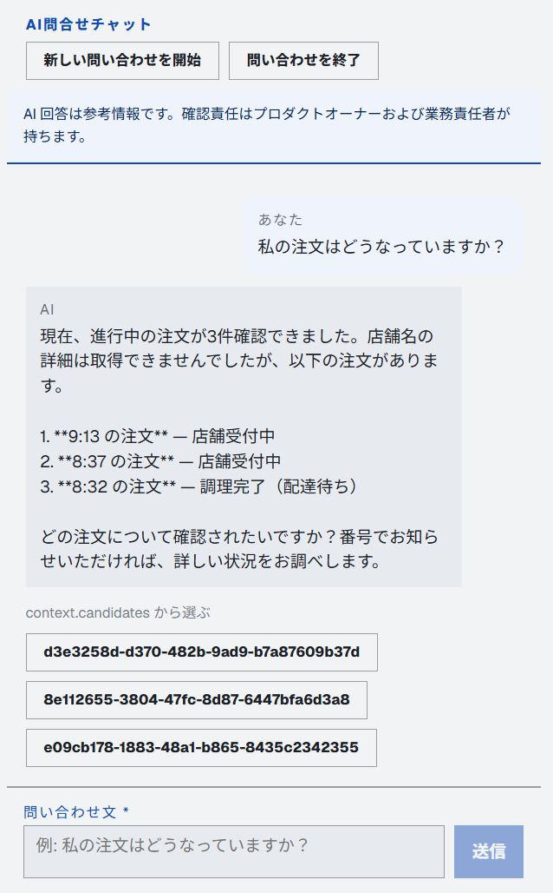

## 4. 店舗従業員の操作

### 4.1 ログインする

**使用するアカウント：** 店舗従業員ロール（`restaurant`）のアカウント

消費者の注文状況画面で確認した `店舗メールアドレス` を使用します。

パスワード：`Passw0rd!`

**アクセス先：** `<ベースURL>/login`

1. 消費者の注文状況画面で、対象注文の `店舗メールアドレス` を確認します。
2. `ログイン` 画面を開きます。
3. `メールアドレス *` に確認した店舗メールアドレスを入力します。
4. `パスワード *` に `Passw0rd!` を入力します。
5. `ログイン` を 1 回押します。
6. `送信中...` と表示されている間は、再度 `ログイン` を押さずに待ちます。
7. `飲食店向け注文確認画面`（SCR-007）が表示されることを確認します。

### 4.2 注文を確認する

**アクセス先：** `<ベースURL>/restaurant/orders`

1. `飲食店向け注文確認画面`（SCR-007）が表示されることを確認します。
2. 最新の注文を確認する場合は `読み込み` を押します。
3. 表の `注文ID`、`状態`、`注文日時` を確認します。
4. 確認する注文の行を押します。
5. `注文詳細` に表示される `注文ID:`、`状態:`、`注文日時:` を確認します。

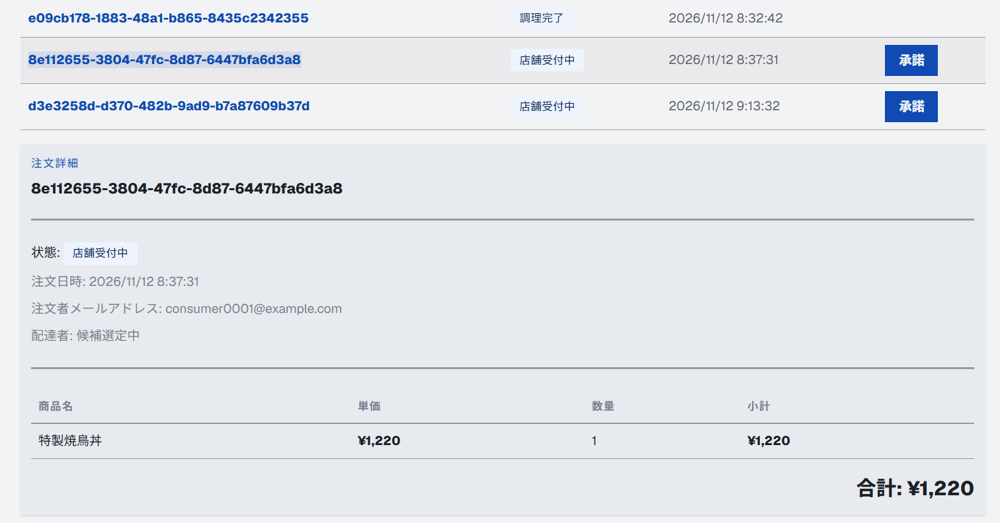

### 4.3 注文を承諾する

**アクセス先：** `<ベースURL>/restaurant/orders`

1. `飲食店向け注文確認画面`（SCR-007）で、表と `注文詳細` の対象 `注文ID` と状態 `店舗受付中` を確認します。
2. 対象行の `承諾` を 1 回押します。
3. 確認ダイアログ「注文 {orderId} を承諾しますか？」で注文 ID を確認します。
4. 承諾する場合は、確認ダイアログで確定します。
5. `処理中...` と表示されている間は、`承諾` を繰り返し押さずに待ちます。
6. `読み込み` を押し、対象注文の状態が更新されていることを確認します。
7. 注文承諾後、店舗側の画面に表示された「配達員候補（受諾待ち）」の 1 ～ 3 位を確認します。
8. 候補として表示された配達員のうち、いずれか 1 名を選びます。
9. 選んだ配達員のメールアドレスを確認します。

`承諾` は状態が `店舗受付中` の注文にだけ表示されます。

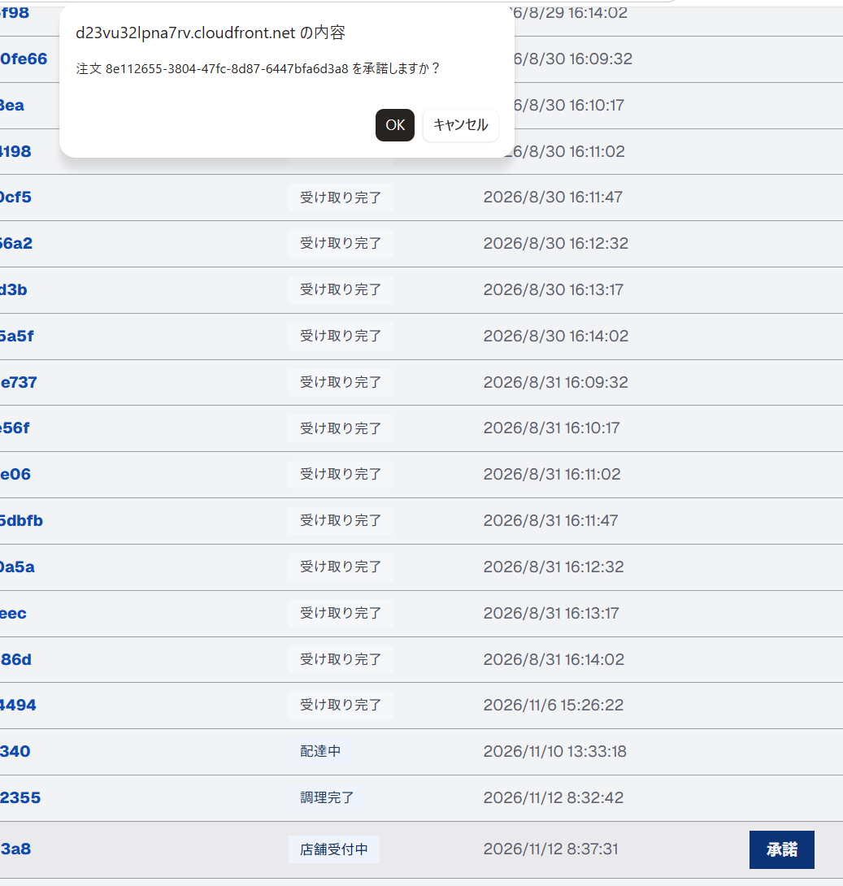

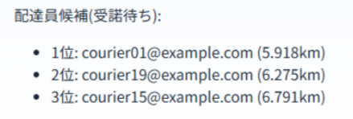

### 4.4 調理完了を登録する

**アクセス先：** `<ベースURL>/restaurant/orders`

1. `飲食店向け注文確認画面`（SCR-007）で、`読み込み` を押し、対象の `注文ID` を確認します。
2. 対象行の状態が `配達員選定完了` であることを確認します。
3. 調理が完了したら、対象行の `調理完了` を 1 回だけ押します。
4. 確認ダイアログ「注文 {orderId} を調理完了に更新しますか？」で注文 ID を確認します。
5. 調理完了を登録する場合は、確認ダイアログで確定します。
6. `更新中...` と表示されている間は、`調理完了` を繰り返し押さずに待ちます。
7. `読み込み` を押し、対象注文の状態が更新されていることを確認します。

`調理完了` は状態が `配達員選定完了` の注文にだけ表示されます。

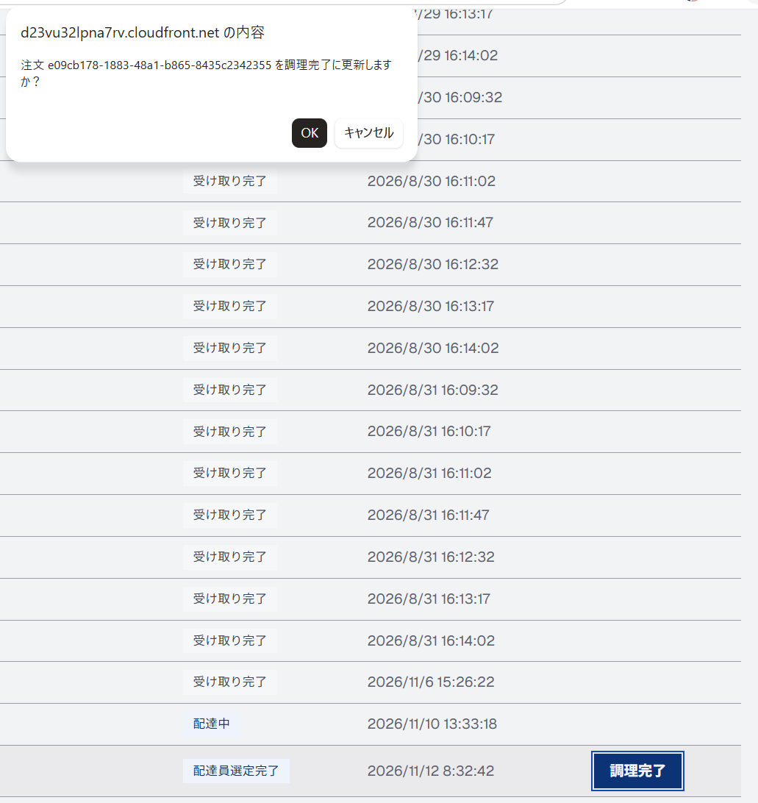

## 5. 配達員の操作

### 5.1 ログインする

**使用するアカウント：** 配達員ロール（`courier`）のアカウント

1. 店舗側の「配達員候補（受諾待ち）」で選んだ配達員のメールアドレスを確認します。
2. 選んだ配達員の認証情報を確認します。
3. `ログイン` 画面を開きます。
4. `メールアドレス *` と `パスワード *` に、確認した認証情報を入力します。
5. `ログイン` を 1 回押します。
6. `配達者向け配達依頼確認画面`（SCR-008）が表示されることを確認します。

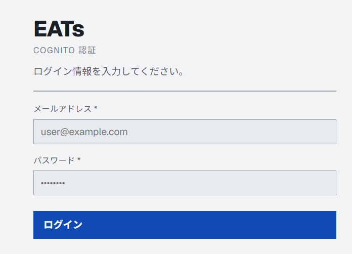

### 5.2 配達依頼を確認する

**アクセス先：** `<ベースURL>/courier/orders`

1. `配達者向け配達依頼確認画面`（SCR-008）が表示されることを確認します。
2. 最新の配達依頼を確認する場合は `手動更新` を押します。
3. `更新中...` または `配達依頼を読み込んでいます...` と表示されている間は、表示が終わるまで待ちます。
4. 各カードの `注文ID:`、`注文状態:`、`配達距離(km):` を確認します。

配達依頼がない場合は `配達依頼はありません。` と表示されます。

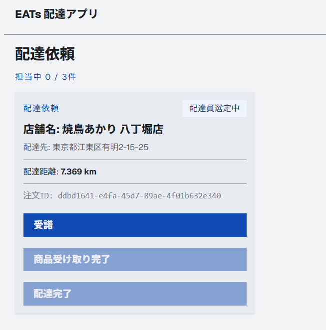

### 5.3 配達依頼を受諾する

**アクセス先：** `<ベースURL>/courier/orders`

1. `配達者向け配達依頼確認画面`（SCR-008）で、対象カードの `注文ID:` と `注文状態: 配達員選定中` を確認します。
2. 対象カードの `受諾` を 1 回だけ押します。
3. `受諾処理中...` と表示されている間は、`受諾` を繰り返し押さずに待ちます。
4. `手動更新` を押し、対象注文の状態が更新されていることを確認します。

`受諾` は状態が `配達員選定中` の依頼でだけ操作できます。

### 5.4 商品受け取り完了を登録する

**アクセス先：** `<ベースURL>/courier/orders`

1. `配達者向け配達依頼確認画面`（SCR-008）で、`手動更新` を押し、対象カードの `注文ID:` を確認します。
2. 対象カードの `注文状態: 調理完了` を確認します。
3. 商品を受け取ったら、`商品受け取り完了` を 1 回だけ押します。
4. `商品受け取り更新中...` と表示されている間は、`商品受け取り完了` を繰り返し押さずに待ちます。
5. `手動更新` を押し、対象注文の状態が `配達中` に更新されていることを確認します。

`商品受け取り完了` は状態が `調理完了` の依頼でだけ操作できます。

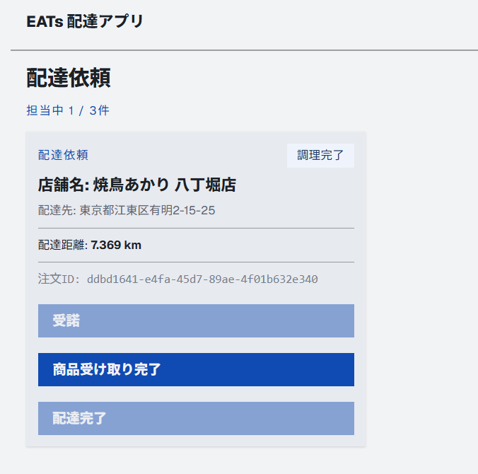

### 5.5 配達完了を登録する

**アクセス先：** `<ベースURL>/courier/orders`

1. `配達者向け配達依頼確認画面`（SCR-008）で、`手動更新` を押し、対象カードの `注文ID:` を確認します。
2. 対象カードの `注文状態: 配達中` を確認します。
3. 配達を完了したら、`配達完了` を 1 回だけ押します。
4. `配達完了更新中...` と表示されている間は、`配達完了` を繰り返し押さずに待ちます。
5. `手動更新` を押し、対象注文の状態が更新されていることを確認します。

`配達完了` は状態が `配達中` の依頼でだけ操作できます。

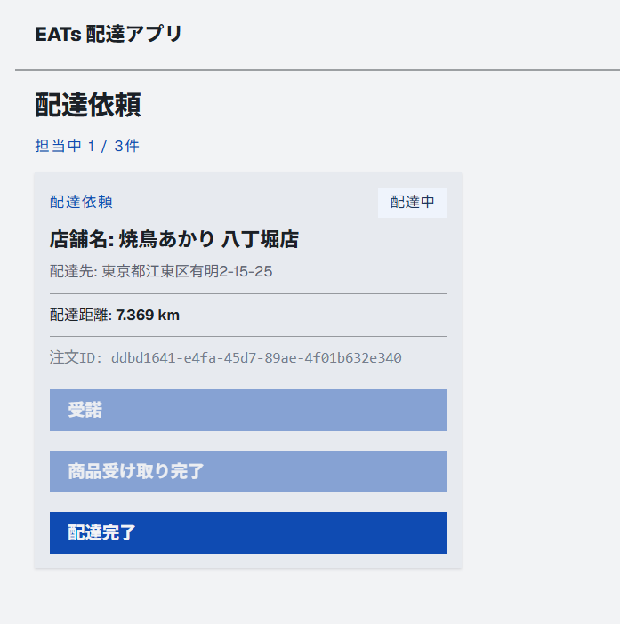

## 6. 利用時の注意事項

- 操作前に、対象の注文 ID と画面上の状態を確認してください。
- `送信中...`、`処理中...`、`更新中...`、`受諾処理中...`、`商品受け取り更新中...`、`配達完了更新中...` が表示されている間は、同じボタンを繰り返し押さないでください。
- 最新の注文状況を確認する場合は、消費者は `再読み込み`、店舗従業員は `読み込み`、配達員は `手動更新` を押します。
- 表示が更新されない場合は、同じ状態変更ボタンを押し直さず、画面の更新操作を使って状態を確認してください。
- 「セッションの有効期限が切れました。再度ログインしてください。」と表示された場合は、`ログイン` 画面へ戻り、再度ログインしてください。

